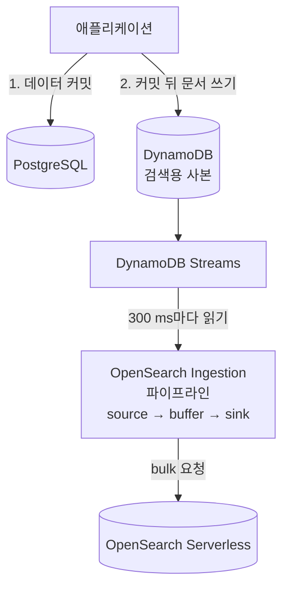
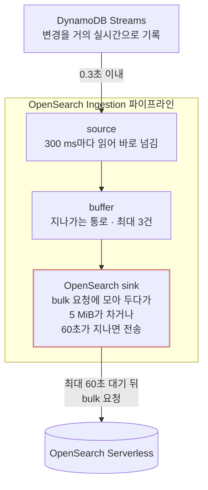
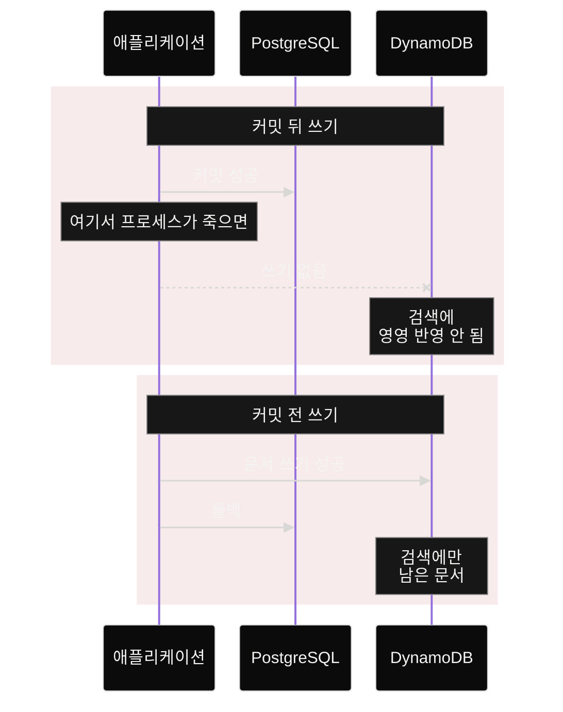
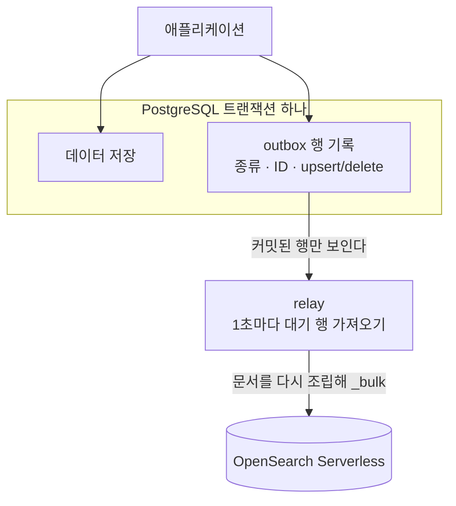
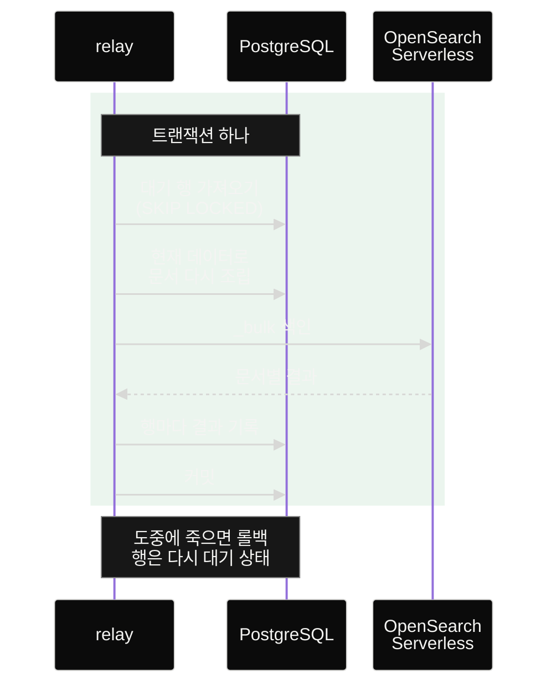
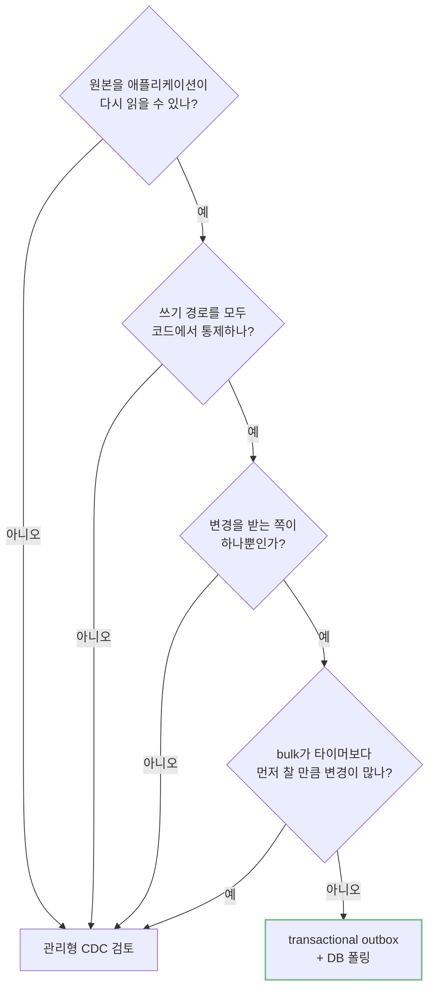

DB에서 바뀐 내용을 검색 엔진으로 옮기는 관리형 변경 데이터 캡처(CDC) 파이프라인은 대량 처리에 맞춰져 있다. 처리량과 상관없이 파이프라인마다 시간 요금이 나간다. 보낼 양이 찰 때까지 최대 60초를 기다리는 기본값 때문에 변경이 꾸준하지만 많지 않은 서비스에서는 색인이 수십 초씩 늦어진다. DynamoDB Streams와 OpenSearch Ingestion을 거치던 검색 색인 경로를 transactional outbox(데이터와 변경 기록을 한 트랜잭션에 저장하는 방식)와 DB 폴링으로 바꾸자 파이프라인 요금이 사라졌고 색인 완료까지 걸리는 시간의 중앙값은 약 28초(추정)에서 1초로 줄었다. DB와 검색용 저장소에 따로 쓰던 dual write(이중 쓰기)의 틈도 함께 닫았다.

아래 표는 검색 색인 경로를 바꾸기 전과 후를 비용, 색인까지 걸리는 시간, 데이터와 검색의 일관성, 관리할 것 네 가지로 비교한 것이다. 각 항목이 왜 이렇게 달라졌는지는 본문에서 하나씩 설명한다.

| | 이전: DynamoDB Streams + OpenSearch Ingestion | 이후: transactional outbox + DB 폴링 |
|---|---|---|
| 비용 | 처리량과 상관없이 파이프라인마다 월 약 $194 (서울 리전 최소 구성) | 기존 DB와 서버에서 돌아 추가 비용이 거의 없다 |
| 색인 완료까지 걸리는 시간 (중앙값) | 약 28초 (추정) | 약 1초 |
| 데이터와 검색의 일관성 | DB와 따로 써서 한쪽만 실패하면 조용히 어긋난다 | 데이터와 변경 기록을 한 트랜잭션에 저장하고 실패하면 다시 시도한다 |
| 관리할 것 | 파이프라인, DynamoDB 테이블과 스트림, 권한, 실패 문서용 버킷 | outbox 테이블, 그것을 읽어 색인하는 프로세스 |

DevOps 담당자가 없는 팀에서 빠르게 개발하며 놓친 인프라를 비용 관점에서 되돌아봤다. 14가지 작업으로 월 약 $2,500을 줄였고 청구서에서 비중이 컸던 항목 중 하나가 이 검색 색인 경로였다. 이 경로를 데이터 종류마다 복제해 넓힌 것도 작년의 나였다. 이 글에서는 관리형 파이프라인의 비용과 지연이 어디서 생기는지, dual write 없이 검색 색인을 맞추는 구조, 자기 서비스에 어느 쪽이 맞는지 가르는 기준을 다룬다.

## 이전 구조

검색 데이터의 원본은 PostgreSQL이고 DynamoDB는 검색에만 쓰는 사본이었다. 애플리케이션이 데이터를 커밋한 뒤 문서를 DynamoDB에 따로 쓰면 OpenSearch Ingestion(이하 OSIS) 파이프라인이 DynamoDB Streams를 읽어 OpenSearch Serverless에 색인했다. OSIS는 오픈소스 Data Prepper를 AWS가 관리형으로 돌려 주는 서비스로, 데이터를 읽는 source와 목적지에 쓰는 sink로 이뤄진다.

처음 이 경로를 구성한 것은 다른 팀이었다. 색인할 변경을 직접 관리하기 번거로우니 관리형 서비스에 맡기자는 판단이었다. 나는 그 구성을 그대로 받아 데이터 종류마다, 환경(prod, staging)마다 복제했고 DynamoDB에 쓰는 애플리케이션 코드도 내가 썼다.

### 처리량과 무관한 비용

OSIS는 처리 용량 단위인 Ingestion OCU로 시간 요금을 받는다. 파이프라인마다 최소 1 OCU가 필요하고 들어오는 데이터가 없어도 이 최소치는 계속 과금된다. 서울 리전에서 1 OCU는 시간당 $0.266이라 파이프라인 하나가 최소 구성으로 월 약 $194다. AWS가 고가용성을 위해 권장하는 2 OCU로 잡으면 월 약 $388이다. 데이터 종류와 환경을 곱한 수만큼 파이프라인이 있었으니 최소 비용도 그만큼 쌓였다.

실제로 거의 아무것도 옮기지 않은 파이프라인도 있었다. 매일 배치가 테이블 전체를 다시 쓰는 데이터를 맡은 파이프라인이었는데 51일 동안 실제로 옮긴 레코드는 1건이었다. DynamoDB Streams는 아이템 데이터를 바꾸지 않는 `PutItem`에는 스트림 레코드를 쓰지 않기 때문이다. 그동안에도 파이프라인은 최소 용량만큼 과금되면서 빈 샤드를 300 ms마다 읽었다.

### 60초 타이머가 정하는 지연

#### DynamoDB Streams가 변경을 모아서 보내는 걸까?

OSIS 지표로 본 파이프라인 구간의 지연은 일평균 25~30초였다. 나는 DynamoDB Streams가 변경이 적을 때 몇 건씩 모아서 전파하기 때문이라고 생각했다. 이 글을 쓰려고 단계별로 다시 확인해 보니 틀린 생각이었다.

Streams는 레코드를 거의 실시간으로 쓴다. OSIS의 DynamoDB source도 샤드를 300 ms마다 읽어 받는 대로 넘긴다. 중간의 buffer에 쌓인 레코드는 최대 3건이었다. 변경이 많지 않아 들어오는 대로 바로 빠져나갔기 때문으로 본다. 문서는 맨 끝의 OpenSearch sink 안에서 기다렸다.

OpenSearch sink는 여러 문서를 묶는 bulk 요청을 `bulk_size`(기본 5 MiB)까지 채우려고 기다린다. 다 채우기 전에 `flush_timeout`(기본 60초)이 지나면 모은 만큼 보낸다. 설정에 두 값을 적지 않았고 시간별 최대 지연이 60초 부근에 몰려 있어 기본값 그대로 돌았다고 본다. 실제 bulk 요청은 평균 36 KB로 5 MiB의 0.7%였다. 전송 시점은 매번 60초 타이머가 정했다.

이 60초는 문서가 들어온 시각이 아니라 sink가 직전에 보낸 시각부터 잰다. sink는 문서를 받을 때마다, 그리고 받을 문서가 없을 때도 주기적으로 "직전 전송 뒤 60초가 지났고 모아 둔 문서가 있는가"를 확인한다. 직전 버스가 떠난 지 60초가 돼야 다음 버스가 출발하는 셔틀과 같다(꽉 차면 바로 출발한다).

그래서 변경이 꾸준하면 전송이 60초마다 한 번씩 일어나고 그 사이에 들어온 문서는 다음 전송까지 기다린다. 직전 전송 직후에 들어온 문서는 59초 가까이, 전송 직전에 들어온 문서는 몇 초만 기다려 평균은 30초가 된다.

<figure class="timer-figure" style="margin: 2rem 0;">
<svg viewBox="0 0 680 290" width="100%" role="img" aria-labelledby="timer-steady-title timer-steady-desc" xmlns="http://www.w3.org/2000/svg" style="display:block;height:auto;max-width:680px" font-family="Pretendard Variable, Pretendard, -apple-system, BlinkMacSystemFont, sans-serif">
<title id="timer-steady-title">변경이 꾸준할 때 60초 타이머가 문서를 기다리게 하는 모습</title>
<desc id="timer-steady-desc">가로축은 0초부터 60초까지의 시간이다. 0초에 직전 전송을 한 뒤 1초, 20초, 45초에 들어온 문서 1, 2, 3은 60초가 될 때까지 보관됐다가 한 번에 전송된다. 문서 1은 59초, 문서 2는 40초, 문서 3은 15초를 기다린다.</desc>
<rect x="0.5" y="0.5" width="679" height="289" fill="#090909" stroke="#303030"/>
<text x="24" y="40" fill="#f4f4f2" font-size="22" font-weight="600">변경이 꾸준할 때</text>
<line x1="60" y1="86" x2="60" y2="236" stroke="#858585" stroke-dasharray="4 4"/>
<text x="60" y="78" fill="#858585" font-size="17">직전 전송 (여기서부터 60초 대기)</text>
<line x1="620" y1="86" x2="620" y2="236" stroke="#78b98c" stroke-width="2"/>
<text x="620" y="78" fill="#78b98c" font-size="17" text-anchor="end">60초에 한 번에 전송</text>
<rect x="69.3" y="116" width="550.7" height="14" fill="#d27b7b" fill-opacity="0.35"/>
<circle cx="69.3" cy="123" r="6" fill="#d27b7b"/>
<text x="610" y="108" fill="#f4f4f2" font-size="19" text-anchor="end">문서 1 (1초) · 59초 대기</text>
<rect x="246.7" y="162" width="373.3" height="14" fill="#d27b7b" fill-opacity="0.35"/>
<circle cx="246.7" cy="169" r="6" fill="#d27b7b"/>
<text x="610" y="154" fill="#f4f4f2" font-size="19" text-anchor="end">문서 2 (20초) · 40초 대기</text>
<rect x="480.0" y="208" width="140.0" height="14" fill="#d27b7b" fill-opacity="0.35"/>
<circle cx="480.0" cy="215" r="6" fill="#d27b7b"/>
<text x="610" y="200" fill="#f4f4f2" font-size="19" text-anchor="end">문서 3 (45초) · 15초 대기</text>
<line x1="60" y1="236" x2="620" y2="236" stroke="#858585"/>
<line x1="60.0" y1="236" x2="60.0" y2="243" stroke="#858585"/>
<text x="60.0" y="266" fill="#858585" font-size="17" text-anchor="middle">0초</text>
<line x1="200.0" y1="236" x2="200.0" y2="243" stroke="#858585"/>
<text x="200.0" y="266" fill="#858585" font-size="17" text-anchor="middle">15초</text>
<line x1="340.0" y1="236" x2="340.0" y2="243" stroke="#858585"/>
<text x="340.0" y="266" fill="#858585" font-size="17" text-anchor="middle">30초</text>
<line x1="480.0" y1="236" x2="480.0" y2="243" stroke="#858585"/>
<text x="480.0" y="266" fill="#858585" font-size="17" text-anchor="middle">45초</text>
<line x1="620.0" y1="236" x2="620.0" y2="243" stroke="#858585"/>
<text x="620.0" y="266" fill="#858585" font-size="17" text-anchor="middle">60초</text>
</svg>
</figure>

반대로 60초 넘게 들어온 문서가 없었다면 시간 조건은 이미 채워져 있어 다음 문서는 들어오자마자 나간다.

<figure class="timer-figure" style="margin: 2rem 0;">
<svg viewBox="0 0 680 270" width="100%" role="img" aria-labelledby="timer-idle-title timer-idle-desc" xmlns="http://www.w3.org/2000/svg" style="display:block;height:auto;max-width:680px" font-family="Pretendard Variable, Pretendard, -apple-system, BlinkMacSystemFont, sans-serif">
<title id="timer-idle-title">60초 넘게 비어 있다가 들어온 문서가 바로 전송되는 모습</title>
<desc id="timer-idle-desc">가로축은 0초부터 100초까지의 시간이다. 0초에 직전 전송을 한 뒤 100초 동안 들어온 문서가 없다. 60초가 지난 시점에 시간 조건이 이미 채워졌으므로 100초에 들어온 문서 4는 기다리지 않고 바로 전송된다.</desc>
<rect x="0.5" y="0.5" width="679" height="269" fill="#090909" stroke="#303030"/>
<text x="24" y="40" fill="#f4f4f2" font-size="22" font-weight="600">60초 넘게 비어 있다가 들어올 때</text>
<line x1="60" y1="86" x2="60" y2="216" stroke="#858585" stroke-dasharray="4 4"/>
<text x="60" y="78" fill="#858585" font-size="17">직전 전송</text>
<line x1="396.0" y1="86" x2="396.0" y2="134" stroke="#858585" stroke-dasharray="4 4"/>
<text x="396.0" y="78" fill="#858585" font-size="17" text-anchor="middle">60초 지남, 시간 조건 충족</text>
<rect x="60" y="100" width="560" height="34" fill="none" stroke="#858585" stroke-dasharray="4 4"/>
<text x="228.0" y="123" fill="#858585" font-size="17" text-anchor="middle">들어온 문서 없음</text>
<line x1="620" y1="86" x2="620" y2="216" stroke="#78b98c" stroke-width="2"/>
<circle cx="620" cy="178" r="7" fill="#78b98c"/>
<text x="604" y="184" fill="#f4f4f2" font-size="19" text-anchor="end">문서 4 (100초) · 받자마자 전송</text>
<line x1="60" y1="216" x2="620" y2="216" stroke="#858585"/>
<line x1="60.0" y1="216" x2="60.0" y2="223" stroke="#858585"/>
<text x="60.0" y="246" fill="#858585" font-size="17" text-anchor="middle">0초</text>
<line x1="172.0" y1="216" x2="172.0" y2="223" stroke="#858585"/>
<text x="172.0" y="246" fill="#858585" font-size="17" text-anchor="middle">20초</text>
<line x1="284.0" y1="216" x2="284.0" y2="223" stroke="#858585"/>
<text x="284.0" y="246" fill="#858585" font-size="17" text-anchor="middle">40초</text>
<line x1="396.0" y1="216" x2="396.0" y2="223" stroke="#858585"/>
<text x="396.0" y="246" fill="#858585" font-size="17" text-anchor="middle">60초</text>
<line x1="508.0" y1="216" x2="508.0" y2="223" stroke="#858585"/>
<text x="508.0" y="246" fill="#858585" font-size="17" text-anchor="middle">80초</text>
<line x1="620.0" y1="216" x2="620.0" y2="223" stroke="#858585"/>
<text x="620.0" y="246" fill="#858585" font-size="17" text-anchor="middle">100초</text>
</svg>
</figure>

변경이 드문 시간대에는 이렇게 바로 나가는 문서가 많아 평균이 10초 남짓이었다. 바쁜 날에는 거의 모든 문서가 다음 전송을 기다려 평균이 30초에 가까워졌다.

5 MiB가 어느 정도인지는 금융 뉴스 기사로 따져 보면 감이 온다. 제목 40자, 본문 2,000자 정도인 기사라면 UTF-8에서 한글은 한 글자에 3바이트, 공백과 숫자는 1바이트라 대략 5 KB가 된다. 실제로 색인하던 문서도 하나에 5 KB 안팎이었다.

| | 크기 | 기사로 치면 |
|---|---:|---:|
| 금융 뉴스 기사 1건 (제목 40자, 본문 2,000자) | 약 5 KB | 1건 |
| 실제 bulk 요청 평균 | 36 KB | 약 7건 |
| `bulk_size` 기본값 | 5 MiB (5,242,880바이트) | 약 1,000건 |

60초 안에 5 MiB를 채우려면 기사 1,000건 분량이 1분마다 꾸준히 들어와야 한다. 그만큼 들어오면 buffer에도 레코드가 쌓이겠지만 bulk가 크기로 먼저 차서 60초 타이머를 기다리지 않는다. 5 MiB와 60초는 이런 대량 처리에 맞춘 값이다. 가장 오래 기다리는 쪽은 변경이 꾸준하지만 그보다 한참 적은 서비스다.

전환을 결정할 때 나는 이 타이머를 몰랐다. 오히려 DynamoDB와 OSIS를 걷어내면 색인이 느려질까 걱정했다. 지연만 문제였다면 설정 한 줄로 끝났을 것이다. `flush_timeout`을 줄이거나 `-1`로 두면 bulk가 차기를 기다리지 않고 묶음마다 보낸다. OSIS도 이 설정을 막지 않는다.

그래도 걷어낼 이유는 남는다. 비용은 이미 최소치인 1 OCU라 더 줄일 곳이 없었다. 애플리케이션이 DynamoDB에 따로 쓰던 dual write도 그대로였다.

## dual write의 틈

### OpenSearch에 직접 쓰면 되지 않을까?

처음에는 DynamoDB와 OSIS만 걷어내고 애플리케이션이 OpenSearch에 바로 쓰게 하려고 했다. 그런데 기존 DynamoDB 쓰기 코드를 다시 보니 문제는 쓰는 대상이 아니라 쓰는 방식에 있었다. DB 커밋과 검색 엔진 쓰기는 한 트랜잭션으로 묶을 수 없다. 대상을 OpenSearch로 바꿔도 dual write는 그대로 남는다.

기존 코드는 쓰는 시점이 경로마다 달랐고 어느 쪽에도 틈이 있었다.

- 커밋 뒤 순차 호출: 커밋과 쓰기 사이에 프로세스가 죽으면 그 변경은 검색에 영영 반영되지 않는다.
- 커밋 후 훅: 호출 위치만 다를 뿐 같은 틈이 있다.
- 커밋 전 쓰기: 외부 쓰기가 성공한 뒤 DB가 롤백되면 검색에만 남은 문서가 생긴다.

대부분의 경로가 실패를 삼켰다. 쓰기 함수가 예외를 로그 한 줄로 바꿨고 이 경로를 지켜보는 알람은 없었다. 실패한 쓰기의 타임아웃을 기다렸다가 예외를 삼키느라 40초씩 걸리던 삭제 스크립트 테스트는 쓰기를 걷어내자 0.55초가 됐다.

주력 데이터는 전환 전 대조에서 검색에서 빠진 문서가 없었다. 다른 데이터에서는 비활성화한 항목이 검색에서 지워지지 않은 일이 있었다. 잘못된 키로 삭제를 요청하고 있었는데 오류가 삼켜져 아무도 몰랐다.

transactional outbox는 이 틈을 메우는 패턴이다. 데이터를 저장하는 트랜잭션 안에서 무엇이 바뀌었는지를 outbox 테이블에 한 줄 기록한다. 별도 프로세스가 커밋된 기록만 읽어 검색 엔진에 반영한다. 검색 엔진 쓰기는 여전히 트랜잭션 밖이지만 반영할 일이 DB에 남아 있으니 실패하면 다시 하면 된다.

## outbox로 바꾼 구조

데이터를 저장할 때 애플리케이션이 추가로 하는 일은 outbox에 행 하나를 넣는 것뿐이다. outbox를 읽어 색인하는 프로세스(이하 relay)가 나머지를 맡는다.

### outbox에 남기는 것

outbox 행에는 문서를 싣지 않는다. 바뀐 데이터의 종류와 ID, upsert인지 delete인지, 그리고 처리 상태(pending, done, failed)와 재시도 기록만 남긴다. relay가 PostgreSQL을 다시 읽어 문서를 조립하므로 이벤트가 쌓이는 사이에 데이터가 또 바뀌어도 항상 현재 상태로 색인한다.

같은 문서의 이벤트가 여러 번 쌓여도 결과는 같으니 중복을 막는 unique 제약은 일부러 두지 않았다. 제약을 걸면 여러 행을 한 번에 넣다가 한 건만 걸려도 데이터를 저장하던 트랜잭션까지 롤백된다. 처리 대기 중인 행만 담는 부분 인덱스를 둬서 처리된 행이 쌓여도 가져갈 행을 빨리 찾는다.

기록은 데이터를 저장하는 트랜잭션 안에서 한다. 기록 함수는 스스로 트랜잭션을 열지 않고 호출한 쪽의 트랜잭션에 참여만 한다. 그래야 데이터와 이벤트가 같은 커밋에 들어간다. Django 시그널로 자동 기록하는 방법은 쓰지 않았다. `QuerySet.update()`처럼 저장 시그널이 발생하지 않는 경로를 놓치기 때문이다.

### relay

relay는 데이터 종류마다 하나씩 항상 떠 있는 프로세스다. 처리 대기 중인 행을 1초마다 한 배치씩 가져오고 배치를 꽉 채워 가져왔으면 쉬지 않고 다음 배치로 넘어간다.

행을 가져오는 일, 문서 조립과 색인, 상태 갱신은 한 트랜잭션 안에서 일어난다. 가져올 때는 `SELECT … FOR UPDATE SKIP LOCKED`로 다른 프로세스가 잠근 행을 건너뛴다. 처리 도중 프로세스가 죽으면 트랜잭션이 롤백돼 행이 대기 상태로 돌아오므로 멈춘 작업을 회수하는 로직이 필요 없다. 그 대가로 OpenSearch를 호출하는 동안 outbox 행의 락을 쥐고 있다. 데이터를 저장하는 쪽은 outbox에 새 행만 넣으니 부딪히지 않았다.

지금은 데이터 종류마다 relay가 하나뿐이다. `SKIP LOCKED`는 relay를 늘릴 때를 위한 장치이고 두 relay를 동시에 돌려 본 적은 아직 없다.

배치는 인덱스마다 `_bulk` 요청 한 번으로 보낸다. 행마다 요청할 때 건당 113 ms이던 시간이 bulk로 6 ms가 됐다.

배치 안에서 같은 문서에 붙은 요청은 마지막 것만 남긴다. 문서를 통째로 덮어쓰므로 같은 이벤트를 두 번 처리해도 결과가 같다. 그래서 최소 한 번 전달(at-least-once)이면 충분하다. 실패한 행은 30초 뒤 다시 가져가고 세 번 실패하면 실패 상태로 남겨 알린다. 처리가 끝난 행은 30일 뒤에 지운다.

옛 경로로 되돌리는 전환 플래그는 두지 않았다. outbox가 그 자체로 안전망이기 때문이다. relay를 멈추면 이벤트는 사라지지 않고 쌓이기만 한다. 유실이 아니라 정지다.

### outbox가 DB에 부담이 되지 않을까?

처음 해 보는 방식이라 가장 걱정한 부분이다. 서비스 테이블과 같은 DB에 이벤트가 계속 쌓이고 다른 프로세스가 1초마다 읽어 간다. 별도 부하 테스트 없이 전환 뒤 운영 지표로 확인했다.

행을 가져오는 쿼리는 실행에 0.047 ms였고 같은 요일끼리 비교한 DB의 CPU와 쓰기 IOPS는 평소 변동 폭 안에 있었다. 가장 바쁜 날에도 Performance Insights의 상위 25개 SQL에 outbox 쿼리는 없었다. 30일치를 보관한 outbox 테이블은 DB 전체의 0.14%다.

## 결과

파이프라인마다 월 약 $194씩 나가던 최소 비용이 사라졌다. DynamoDB Streams 읽기 요금과 초기 적재용으로 켜 두었던 특정 시점 복구(PITR) 요금도 함께 없어졌다. 다만 쓰기를 끊은 뒤에도 비용은 파이프라인을 멈출 때까지 나갔다. Streams 요금은 쓰는 쪽이 아니라 읽는 쪽의 요청에 붙고 OSIS는 쓰기가 없어도 300 ms마다 샤드를 읽었기 때문이다.

새로 생긴 비용은 거의 없다. outbox 테이블은 이미 할당된 DB 저장 공간 안에 있고 relay 하나는 CPU 약 0.015코어, 메모리 약 320 MiB로 기존 Kubernetes 노드에서 돈다. OpenSearch Serverless 용량도 그대로여서 비용이 다른 곳으로 옮겨 가지 않았다.

여기까지는 사용량 기준이다. 약정 할인이 있는 계정이라면 청구서에 언제 드러나는지는 따로 봐야 한다.

색인도 빨라졌다. 색인 완료까지 걸리는 시간의 중앙값이 약 28초에서 1초 안팎이 됐다. 전환 전 값은 문서마다 잰 애플리케이션 구간에 OSIS 지표의 평균 28.4초를 더해 추정했다.

## outbox로 바꿔도 남은 것

outbox가 조용한 실패를 모두 없애지는 않았다. 몇 가지는 자리만 옮겼다.

- 이벤트 기록을 빠뜨린 쓰기 경로는 에러 없이 인덱스만 조용히 낡게 만든다. 전환하면서 몇 곳을 찾아 고쳤고 아직 남은 경로도 있다.
- relay는 죽어도 스스로 신호를 내지 않는다. 지금은 5분마다 실패 행과 가장 오래된 대기 행의 나이를 보고 알린다. 그래서 relay가 멈추면 대기 행이 쌓여 알림이 오지만 이벤트가 아예 들어오지 않으면 바뀐 게 없는 것인지 쓰는 쪽이 멈춘 것인지 구분할 수 없다.
- OpenSearch Serverless가 성공 응답을 준 뒤 내부에서 문서를 버리는 경우가 있었다. relay는 그 행을 처리 완료로 기록한다.

## 규모에 따른 선택

관리형 CDC 파이프라인이 틀린 선택은 아니다. 아래 질문 중 하나라도 CDC 쪽으로 가면 여전히 관리형 CDC가 낫다고 본다. outbox는 기록을 빠뜨린 쓰기 경로를 잡지 못하므로 쓰기 경로를 전부 통제할 수 없다면 DB 수준에서 변경을 잡는 쪽이 안전하다.

자기 파이프라인이 어느 쪽인지는 세 가지를 보면 안다. 평균 bulk 크기가 `bulk_size`보다 한참 작으면 전송 시점은 타이머가 정한다. 최소 OCU × 단가 × 730시간이 옮기는 데이터 양에 비해 크면 최소 비용이 과한 것이다. 원본 데이터와 색인용 사본을 따로 쓰고 있다면 dual write다. 반대로 outbox로 옮긴 뒤 가장 오래된 대기 행의 나이가 꾸준히 늘거나 relay가 매번 배치를 꽉 채워 간다면 그때가 CDC를 다시 볼 때다.

가장 가까운 대안은 OSIS 대신 Lambda가 스트림을 읽게 하는 것이다. 시간 요금과 60초 타이머는 사라지지만 DynamoDB 사본과 dual write는 그대로 남는다. Debezium 같은 CDC 도구는 걷어내려는 것과 같이 항상 켜져 있는 인프라를 다시 들이는 데다 읽는 쪽이 밀리면 PostgreSQL이 변경 로그(WAL)를 붙잡아 디스크를 압박한다. PostgreSQL의 `LISTEN/NOTIFY`는 리스너가 죽어 있으면 알림이 사라진다. 1초 폴링만으로 충분했다.

## 정리

관리형 파이프라인이 덜어 주는 수고는 처리량이 클 때 값을 한다. 변경이 꾸준하지만 많지 않은 서비스에서는 같은 설계 때문에 비용과 지연이 생겼다. 옮길 데이터가 거의 없어도 파이프라인마다 시간 요금을 냈고 색인은 60초 타이머를 기다렸다.

그 비용과 대기는 transactional outbox로 바꾸자 사라졌다. dual write의 틈도 닫았다. 대신 이벤트 기록을 빠뜨리지 않을 책임은 애플리케이션 코드로 넘어왔다. 다시 관리형 서비스를 붙인다면 최소 비용과 배치 기본값부터 확인할 것이다.

최소 용량, 5 MiB, 60초처럼 큰 규모에 맞춘 값은 작은 규모에서 그대로 비용과 지연이 된다.

## 참고

- [Scaling pipelines in Amazon OpenSearch Ingestion](https://docs.aws.amazon.com/opensearch-service/latest/developerguide/ingestion-scaling.html)
- [Supported plugins and options for Amazon OpenSearch Ingestion pipelines](https://docs.aws.amazon.com/opensearch-service/latest/developerguide/pipeline-config-reference.html)
- [Data Prepper OpenSearch sink](https://docs.opensearch.org/latest/data-prepper/pipelines/configuration/sinks/opensearch/)
- [Change data capture for DynamoDB Streams](https://docs.aws.amazon.com/amazondynamodb/latest/developerguide/Streams.html)
- [Amazon OpenSearch Serverless](https://docs.aws.amazon.com/opensearch-service/latest/developerguide/serverless-overview.html)
- [Pattern: Transactional outbox](https://microservices.io/patterns/data/transactional-outbox.html)
