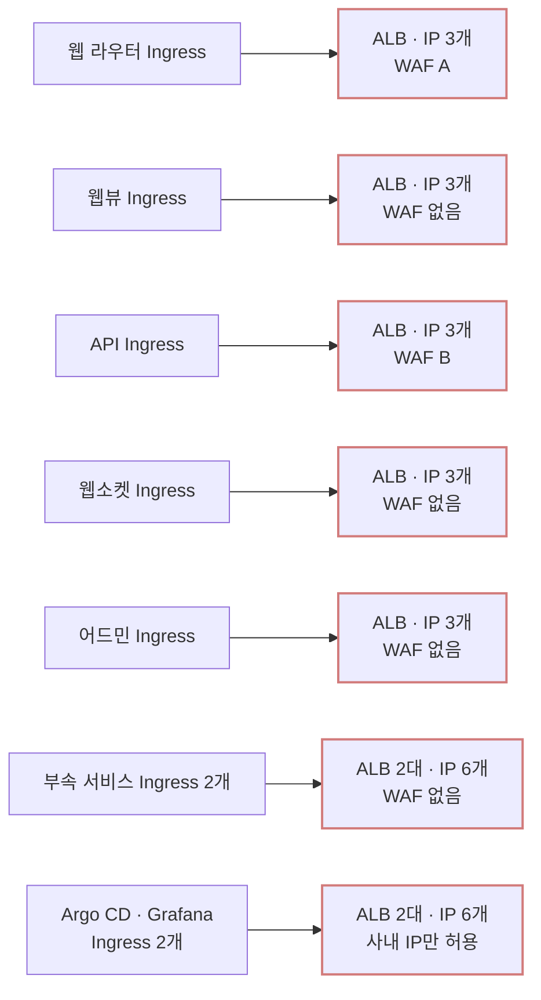
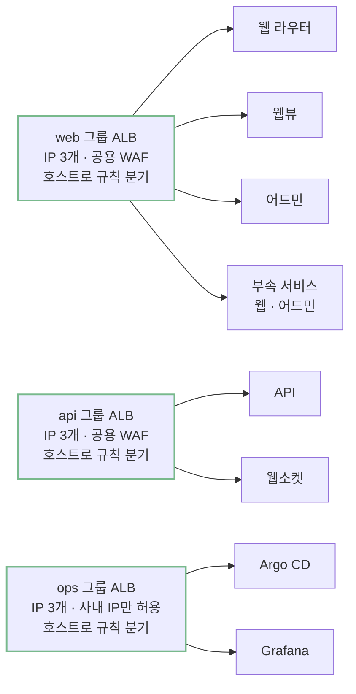
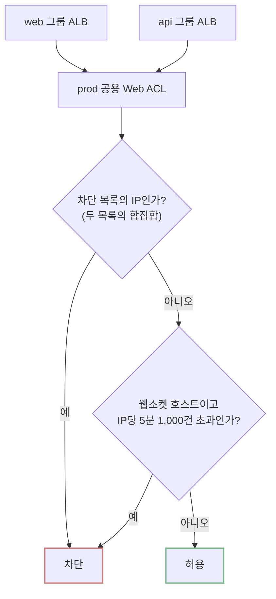
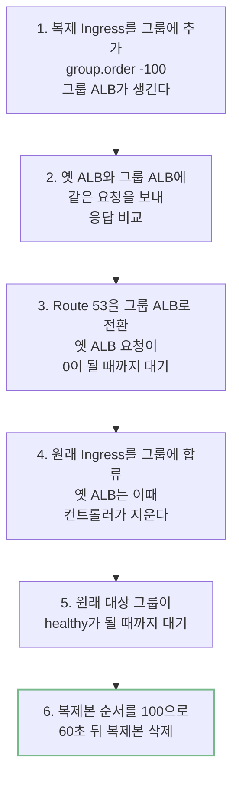
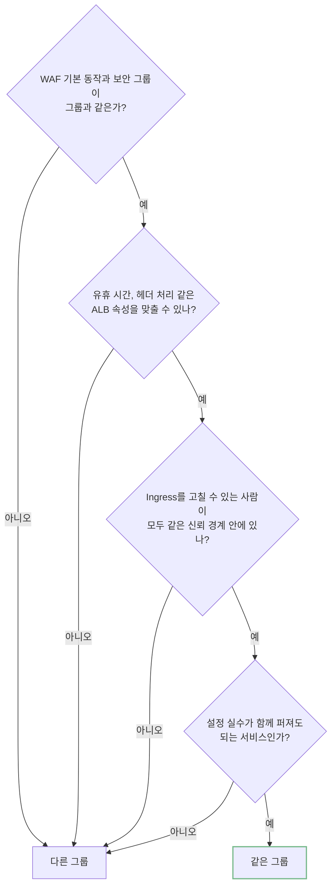

AWS Load Balancer Controller로 Ingress를 운영한다면 Ingress마다 ALB가 하나씩 떠 있을 가능성이 크다. 그룹을 정하지 않은 Ingress마다 ALB를 하나씩 만드는 것이 컨트롤러의 기본 동작이다. ALB 한 대는 요청이 없어도 서울 리전에서 월 약 $27.38이 나가고 트래픽 요금(LCU)은 처리하는 데이터가 시간당 약 4.7 GB(한 달 약 3.4 TB)를 넘어야 이 금액을 넘는다. 그보다 적게 처리하는 ALB가 대부분이라면 ALB 요금은 트래픽이 아니라 대수가 정한다.

아래 표는 묶기 전과 후를 ALB 대수, 대수로 나가는 최소 비용, 트래픽 요금, WAF로 나눠 비교한 것이고 달라진 이유는 본문에서 설명한다.

| | 이전: Ingress마다 ALB | 이후: IngressGroup |
|---|---|---|
| ALB 대수 | 17대 (prod 9, staging 8) | 6대 (환경마다 web, api, ops 그룹) |
| 대수로 나가는 최소 비용 (서울 리전, 시간 요금과 공인 IPv4) | 월 약 $465 | 월 약 $164 |
| 트래픽 요금 | 처리한 데이터에 비례 | 그대로 |
| WAF | 규칙 묶음(Web ACL) 6개, 사용자가 쓰는 prod ALB 7대 중 2대에만 연결 | 규칙 묶음 3개, 사용자가 쓰는 ALB 모두에 그룹 단위로 연결 |

DevOps 담당자가 없는 팀에서 빠르게 개발하며 놓친 인프라를 비용 관점에서 되돌아봤다. 14가지 작업으로 월 약 $2,500을 줄였고 청구서 항목을 하나씩 확인하다가 ALB가 Ingress마다 하나씩 떠 있고 대부분 트래픽이 거의 없다는 것을 알게 됐다. 이 ALB 17대를 IngressGroup으로 성격이 같은 것끼리 묶어 6대로 줄였고 따로 붙어 있던 WAF도 그룹마다 하나로 정리했다. 이 글에서는 그룹을 나눈 기준과 WAF를 그룹 단위로 옮긴 방법, 기존 Ingress를 끊김 없이 옮기는 순서를 정리한다.

## Ingress마다 ALB가 생기는 이유

AWS Load Balancer Controller는 Kubernetes Ingress를 읽어 ALB를 만들고 관리한다. 컨트롤러는 Ingress를 그룹 단위로 다루고 그룹 하나에 ALB 하나를 만든다. 그런데 그룹을 지정하지 않은 Ingress는 자기 혼자 하나의 그룹이 된다. 문서는 이것을 이렇게 설명한다.

> By default, Ingresses don't belong to any IngressGroup, and we treat it as a "implicit IngressGroup" consisting of the Ingress itself.

그래서 Ingress를 하나 만들 때마다 ALB가 하나 생긴다. 팀 클러스터에서는 3년 동안 여러 사람이 서비스를 하나씩 추가하면서 Ingress가 늘었다. 앱마다 배포 저장소가 따로 있었고 같은 Helm 차트를 쓰는 앱도 릴리스마다 Ingress가 하나씩 생겼다. 그룹을 지정한 Ingress는 하나도 없었다.

prod에서는 웹 주소로 들어온 요청을 PC 웹과 모바일 웹으로 나눠 보내는 웹 라우터, 모바일 앱 안에서 여는 웹 화면인 웹뷰, API, 웹소켓, 어드민, 부속 서비스, 운영 도구가 저마다 ALB를 갖고 있었다. API와 처음 만든 Argo CD의 Ingress는 내가 만들었다.



팀은 IngressGroup을 알고도 쓰지 않았다. 새 서비스의 배포 설계 문서에 "기존 프로젝트들도 모두 쓰지 않는다"는 이유로 전용 ALB를 고른 기록이 있었다. 처음 기본값대로 만든 구성이 관행이 됐고 새 서비스도 그 관행을 따랐다.

## 대수가 정하는 ALB 요금

### 대당 최소 비용

ALB에는 떠 있는 시간마다 붙는 시간 요금과 처리한 트래픽에 붙는 LCU 요금이 나간다. 서울 리전에서 시간 요금은 시간당 $0.0225라 한 대에 월 $16.43이다.

여기에 공인 IPv4 요금이 더해진다. AWS는 2024년 2월부터 모든 공인 IPv4에 하나당 시간 $0.005를 받는다. 인터넷에 열린 ALB는 가용 영역마다 노드를 하나 두고 노드마다 공인 IPv4를 하나 쓴다. 가용 영역 3개에 걸친 ALB라면 IP 3개로 월 $10.95다.

묶기 전 ALB 17대는 모두 가용 영역 3개에 걸쳐 있었고 트래픽이 평소의 열 배가 넘던 날에도 IP는 3개에서 늘지 않았다. 시간 요금과 더하면 ALB 한 대는 요청이 하나도 없어도 월 $27.38이다. 그중 40%가 공인 IPv4다. 17대면 월 약 $465, 6대면 월 약 $164다.

### 트래픽 요금이 최소 비용을 넘는 지점

LCU(Load Balancer Capacity Unit)는 ALB가 처리한 트래픽을 네 가지 측정 기준으로 잰 단위다. 시간마다 넷 중 가장 큰 값 하나로 과금하고 1 LCU는 시간당 $0.008이다.

| 측정 기준 | 1 LCU |
|---|---|
| 새 연결 | 초당 25개 |
| 활성 연결 | 분당 3,000개 |
| 처리한 데이터 | 시간당 1 GB |
| 규칙 평가 | 초당 1,000회 (처음 10개 규칙은 무료) |

대당 최소 비용은 시간당 $0.0375(시간 요금 $0.0225 + IP 3개 $0.015)이고 LCU 4.7개 값과 같다. 처리한 데이터로 치면 시간당 약 4.7 GB다. 새 연결로 치면 초당 약 117개다. ALB 한 대가 이보다 적게 쓰면 트래픽 요금보다 대당 최소 비용이 더 크다.

<figure class="alb-figure" style="margin: 2rem 0;">
<svg viewBox="0 0 680 360" width="100%" role="img" aria-labelledby="alb-breakeven-title alb-breakeven-desc" xmlns="http://www.w3.org/2000/svg" style="display:block;height:auto;max-width:680px" font-family="Pretendard Variable, Pretendard, -apple-system, BlinkMacSystemFont, sans-serif">
<title id="alb-breakeven-title">ALB 한 대의 월 요금과 처리하는 데이터의 관계</title>
<desc id="alb-breakeven-desc">가로축은 ALB 한 대가 시간당 처리하는 데이터로 0부터 8 GB까지다. 세로축은 월 요금으로 0부터 50달러까지다. 대당 최소 비용은 처리량과 상관없이 27.38달러로 수평이다. 트래픽 요금은 처리량에 비례해 늘고 시간당 약 4.7 GB에서 최소 비용과 같아진다. 묶기 전 ALB 17대는 모두 시간당 2 GB 아래에 있었다.</desc>
<rect x="0.5" y="0.5" width="679" height="359" fill="#090909" stroke="#303030"/>
<text x="24" y="40" fill="#f4f4f2" font-size="22" font-weight="600">ALB 한 대의 월 요금 (서울 리전)</text>
<rect x="90" y="90" width="137.5" height="200" fill="#78b98c" fill-opacity="0.12"/>
<text x="98" y="112" fill="#78b98c" font-size="16">묶기 전 ALB 17대</text>
<line x1="90" y1="250" x2="640" y2="250" stroke="#303030"/>
<line x1="90" y1="210" x2="640" y2="210" stroke="#303030"/>
<line x1="90" y1="170" x2="640" y2="170" stroke="#303030"/>
<line x1="90" y1="130" x2="640" y2="130" stroke="#303030"/>
<line x1="90" y1="180.5" x2="640" y2="180.5" stroke="#d27b7b" stroke-width="3"/>
<text x="98" y="170" fill="#d27b7b" font-size="17">대당 최소 비용 $27.38</text>
<text x="98" y="206" fill="#d27b7b" font-size="15">시간 $16.43 + IPv4 3개 $10.95</text>
<line x1="90" y1="290" x2="640" y2="103.1" stroke="#d8d8d6" stroke-width="2"/>
<text x="632" y="92" fill="#d8d8d6" font-size="17" text-anchor="end">트래픽 요금 (LCU)</text>
<line x1="412.3" y1="180.5" x2="412.3" y2="290" stroke="#858585" stroke-dasharray="4 4"/>
<circle cx="412.3" cy="180.5" r="6" fill="#f4f4f2"/>
<text x="420" y="270" fill="#f4f4f2" font-size="17">시간당 약 4.7 GB</text>
<line x1="90" y1="290" x2="640" y2="290" stroke="#858585"/>
<line x1="90" y1="90" x2="90" y2="290" stroke="#858585"/>
<text x="80" y="295" fill="#858585" font-size="15" text-anchor="end">$0</text>
<text x="80" y="255" fill="#858585" font-size="15" text-anchor="end">$10</text>
<text x="80" y="215" fill="#858585" font-size="15" text-anchor="end">$20</text>
<text x="80" y="175" fill="#858585" font-size="15" text-anchor="end">$30</text>
<text x="80" y="135" fill="#858585" font-size="15" text-anchor="end">$40</text>
<text x="80" y="95" fill="#858585" font-size="15" text-anchor="end">$50</text>
<line x1="90" y1="290" x2="90" y2="297" stroke="#858585"/>
<text x="90" y="316" fill="#858585" font-size="16" text-anchor="middle">0</text>
<line x1="227.5" y1="290" x2="227.5" y2="297" stroke="#858585"/>
<text x="227.5" y="316" fill="#858585" font-size="16" text-anchor="middle">2</text>
<line x1="365" y1="290" x2="365" y2="297" stroke="#858585"/>
<text x="365" y="316" fill="#858585" font-size="16" text-anchor="middle">4</text>
<line x1="502.5" y1="290" x2="502.5" y2="297" stroke="#858585"/>
<text x="502.5" y="316" fill="#858585" font-size="16" text-anchor="middle">6</text>
<line x1="640" y1="290" x2="640" y2="297" stroke="#858585"/>
<text x="640" y="316" fill="#858585" font-size="16" text-anchor="middle">8</text>
<text x="365" y="344" fill="#858585" font-size="16" text-anchor="middle">시간당 처리하는 데이터 (GB)</text>
</svg>
</figure>

묶기 전 ALB에서는 거의 언제나 처리한 데이터가 가장 큰 측정 기준이었고 가장 바쁜 ALB도 4.7 GB 선에 한참 못 미쳤다. 트래픽 요금의 98%가 사용자 트래픽을 받는 prod ALB 3대에서 나왔고 나머지 14대는 다 합쳐 한 달 트래픽 요금이 $0.21이었다. 3월부터 9월까지 매달 ALB 요금(시간, 공인 IPv4, LCU)의 94~97%가 대당 최소 비용이었다. 7월까지의 공인 IPv4 요금은 청구서의 ALB 시간으로 계산한 값이다.

### 청구서의 ELB 항목이 더 큰 이유

작업 기록에는 "ALB 비용의 97%가 대당 최소 비용"이라고 적어 두었다. 이 글을 쓰려고 청구서를 다시 나눠 보니 Elastic Load Balancing 항목 전체로는 이 비율이 나오지 않았다. 이 항목에는 ALB 요금 말고도 ALB가 인터넷으로 내보낸 데이터의 전송 요금(서울 리전 GB당 $0.126)이 함께 잡히기 때문이다. 이 계정에서는 송신 요금이 LCU 요금의 14~15배였다.

<figure class="alb-figure" style="margin: 2rem 0;">
<svg viewBox="0 0 680 230" width="100%" role="img" aria-labelledby="alb-bill-title alb-bill-desc" xmlns="http://www.w3.org/2000/svg" style="display:block;height:auto;max-width:680px" font-family="Pretendard Variable, Pretendard, -apple-system, BlinkMacSystemFont, sans-serif">
<title id="alb-bill-title">묶기 전 30일 청구서의 Elastic Load Balancing 항목 구성</title>
<desc id="alb-bill-desc">막대 하나를 100%로 놓고 나눈 그림이다. 시간 요금 41%, 공인 IPv4 27%, LCU 2%, 인터넷 송신 30%다. 앞의 세 가지가 ALB 요금으로 전체의 70%이고 그중 97%가 대당 최소 비용이다. 인터넷 송신 30%는 데이터 전송 요금이라 ALB 대수와 상관이 없다.</desc>
<rect x="0.5" y="0.5" width="679" height="229" fill="#090909" stroke="#303030"/>
<text x="24" y="40" fill="#f4f4f2" font-size="20" font-weight="600">청구서의 ELB 항목 (묶기 전 30일)</text>
<text x="24" y="96" fill="#f4f4f2" font-size="16">시간 요금 41%</text>
<text x="286" y="96" fill="#f4f4f2" font-size="16">공인 IPv4 27%</text>
<text x="462" y="96" fill="#f4f4f2" font-size="16" text-anchor="middle">LCU 2%</text>
<text x="656" y="96" fill="#f4f4f2" font-size="16" text-anchor="end">인터넷 송신 30%</text>
<rect x="24" y="108" width="258.5" height="40" fill="#d27b7b"/>
<rect x="282.5" y="108" width="173.2" height="40" fill="#d27b7b" fill-opacity="0.6"/>
<rect x="455.7" y="108" width="13.3" height="40" fill="#d8d8d6"/>
<rect x="469" y="108" width="187" height="40" fill="#858585" fill-opacity="0.5"/>
<path d="M24 162 V172 H467 V162" fill="none" stroke="#858585"/>
<text x="243" y="198" fill="#f4f4f2" font-size="16" text-anchor="middle">ALB 요금 70% · 그중 97%가 대당 최소 비용</text>
<path d="M473 162 V172 H656 V162" fill="none" stroke="#858585"/>
<text x="565" y="198" fill="#858585" font-size="16" text-anchor="middle">대수와 무관한 전송 요금</text>
</svg>
</figure>

송신까지 넣으면 대당 최소 비용의 비중은 70% 아래로 내려가고 송신이 많던 3월에는 절반에 못 미쳤다. 하지만 송신 요금은 응답으로 나간 바이트에 붙는 데이터 전송 요금이라 ALB가 몇 대든 같다. 크롤러가 몰린 주에는 ALB 한 대가 평소의 열 배 넘게 내보냈는데 그때도 늘어난 요금의 94%는 송신 요금이었다. ALB 대수를 줄이면 ALB 요금이 줄고 그중 대부분이 대당 최소 비용이다.

## IngressGroup

### 여러 Ingress가 ALB 하나를 쓰는 방법

IngressGroup은 같은 그룹 이름을 단 Ingress들을 ALB 하나로 합치는 기능이다. 컨트롤러 v2.0.0(2020년)부터 있었다. 각 Ingress의 호스트와 경로 규칙은 그룹 ALB의 리스너 규칙으로 들어가고 ALB는 이 규칙을 순서대로 보고 요청을 대상 그룹(target group)으로 보낸다. 대상 그룹은 요청을 받을 Pod의 목록이고 Service마다 따로 생긴다.

그룹 이름과 순서는 Ingress annotation으로 정한다.

```yaml
metadata:
  annotations:
    alb.ingress.kubernetes.io/group.name: prod-web
    alb.ingress.kubernetes.io/group.order: "-10"
```

`group.order`는 그룹 안에서 규칙을 평가할 순서다. -1000부터 1000까지 쓸 수 있고 적지 않으면 0이다. 값이 같으면 `namespace/name` 사전순이다.

순서는 리스너의 기본 인증서도 정한다. 기본 인증서는 접속할 호스트 이름(SNI)을 보내지 않는 클라이언트가 받는 인증서이고 그 포트에서 인증서를 가진 첫 Ingress의 첫 인증서가 기본이 된다. 이름순으로 어드민 Ingress가 앞에 와서 어드민 전용 인증서가 기본이 될 뻔했다. 와일드카드 인증서를 가진 Ingress에 `-10`을 줘서 막았다.



### 그룹에 하나뿐인 설정

Ingress마다 달 수 있는 annotation이 그룹으로 묶이면 세 종류로 갈린다.

| 구분 | 예 | 그룹에서 |
|---|---|---|
| Exclusive | `scheme`, `security-groups`, `wafv2-acl-arn`, `load-balancer-attributes`, `ssl-policy`, `ssl-redirect`, `inbound-cidrs` | 그룹 전체에 값이 하나여야 한다 |
| Merge | `listen-ports`, `certificate-arn`, `tags` | Ingress마다 적은 값을 합친다 |
| Ingress마다 | 호스트·경로 규칙, 헬스 체크 | 각자의 규칙과 대상 그룹이 된다 |

Exclusive 설정은 ALB 하나에 하나만 있을 수 있는 값이다. 보안 그룹, WAF, TLS 정책, 유휴 시간이나 접속 로그 같은 ALB 속성이 여기에 든다. 그룹 안의 Ingress들이 이 값을 서로 다르게 적으면 컨트롤러는 하나를 고르지 않고 그룹 전체의 반영을 멈춘다. 값을 적지 않은 Ingress는 충돌로 치지 않는다.

그래서 Exclusive 설정을 기준으로 묶는다. 이 값이 같은, 또는 같게 맞출 수 있는 Ingress끼리 한 그룹에 넣는다.

### 세 그룹으로 나눈 이유

Exclusive 설정 가운데 WAF, 보안 그룹, ALB 속성과 장애가 퍼지는 범위를 봤다. Web ACL은 ALB 하나에 하나만 붙는다. 사무실에서만 열리는 staging 웹 화면과 외부 제휴사가 쓰는 staging 사이트는 WAF의 기본 동작부터 달라 같은 그룹에 둘 수 없었다.

Argo CD와 Grafana는 사내 IP만 받는 보안 그룹을 쓴다. 공개 앱과 같은 ALB에 두면 제한이 풀리거나 앱이 막힌다. 그래서 운영 도구는 따로 묶었다.

ALB 속성 가운데 유휴 시간(idle timeout)은 데이터가 오가지 않는 연결을 ALB가 끊기 전까지 기다리는 시간으로 웹소켓 ALB만 3,600초이고 나머지는 60초였다. 웹소켓 서버(uvicorn)는 기본으로 20초마다 핑을 보내 연결을 살려 둔다. staging에서 클라이언트 핑을 끈 채 60초 ALB로 연결을 열어 두니 180초 동안 끊기지 않았다. 그래서 웹소켓도 60초로 맞춰 API와 묶었다.

잘못된 헤더를 버리는 속성(`routing.http.drop_invalid_header_fields.enabled`)은 API만 꺼야 했다. API 서버(gunicorn 21)가 밑줄이 든 헤더를 받고 있어 켜면 동작이 바뀌기 때문이다.

ALB 하나가 여러 앱을 받으면 설정 실수 한 번이 그룹 전체에 퍼진다. 사용자 트래픽의 99%를 받는 API와 웹 화면은 다른 그룹에 뒀다.

| 그룹 | 묶은 Ingress (prod) | 나눈 이유 |
|---|---|---|
| web | 웹 라우터, 웹뷰, 어드민, 부속 서비스 웹·어드민 (5개) | 브라우저가 여는 화면. 잘못된 헤더 처리를 켤 수 있다 |
| api | API, 웹소켓 (2개) | 사용자 트래픽 대부분을 받는다. 잘못된 헤더 처리를 꺼야 한다 |
| ops | Argo CD, Grafana (2개) | 사내 IP만 받는 보안 그룹 |

staging도 같은 세 그룹으로 나눴다. 제휴사 사이트만 사무실 전용 WAF가 걸린 web 그룹 대신 api 그룹에 넣었다. 규칙 한도는 넉넉했다. ALB 하나에 규칙 100개까지 쓸 수 있는데 가장 많은 그룹이 29개였다.

그룹에 들어올 수 있는 사람도 기준이다. 같은 그룹 이름을 단 Ingress는 누구나 그 ALB에 규칙을 더하거나 더 앞선 순서로 덮을 수 있다. 문서도 Ingress를 만들고 고칠 권한을 가진 사람이 모두 같은 신뢰 경계 안에 있을 때만 쓰라고 경고한다. 이 클러스터는 한 팀이 쓰고 Ingress를 고치는 사람도 모두 그 팀이라 조건을 채운다고 봤다.

### 묶은 뒤의 트래픽 요금

ALB를 합치면 트래픽 요금이 오를 수도 있다. LCU를 ALB마다 시간 단위로 따로 계산하기 때문이다. 처리한 데이터처럼 더해지는 기준은 오히려 같거나 줄어든다. ALB마다 시간별 최댓값을 따로 내던 것이 합친 값의 최댓값 하나가 되기 때문이다.

규칙 평가는 늘어날 수 있다. 한 ALB에 규칙이 많아지면 요청 하나가 지나가는 규칙 수가 늘어 무료 10개를 넘는다.

실제로 web 그룹은 리스너마다 규칙이 10개가 됐고 웹뷰 요청이 웹 라우터 규칙 뒤에서 평가되면서 규칙 평가 횟수가 약 3배가 됐다. 그래도 묶은 뒤 288시간 내내 처리한 데이터가 가장 큰 기준이어서 요금은 그대로였다. 처리한 데이터 1 GB당 LCU는 묶기 전 1.03, 묶은 뒤도 1.03이었다. 요청은 많은데 응답이 작은 서비스를 규칙이 많은 그룹에 넣는다면 규칙 평가가 가장 큰 기준이 될 수 있다.

## 그룹 단위 WAF

### Ingress마다 따로 붙어 있던 WAF

Web ACL은 WAF 규칙의 묶음이다. ALB에 연결하면 그 ALB로 들어오는 요청을 이 규칙들로 검사한다.

묶기 전에는 Web ACL이 6개였다. Terraform으로 만든 것과 콘솔에서 만든 것이 섞여 있었고 그중 2개는 어디에도 연결되지 않은 채 요금만 나갔다. 사용자가 쓰는 prod ALB 7대 중 WAF가 붙은 것은 웹 라우터와 API 둘뿐이었다. 웹 라우터에서 막은 IP가 웹뷰 호스트로 들어오면 그대로 통과했다.

컨트롤러 v2.0.0부터 v2.8.1까지는 Ingress에 WAF annotation이 없으면 콘솔에서 붙인 WAF까지 떼어 낸다. 웹소켓 ALB에 콘솔로 붙인 WAF가 실제로 이렇게 떨어졌다. v2.8.2부터는 annotation이 없으면 건드리지 않는다. 그래서 그룹을 합치기 전에 v2.4.7에 머물러 있던 컨트롤러를 v2.17.1로 올리고 WAF를 annotation으로 관리하게 바꿨다.

### 그룹마다 하나인 Web ACL

`wafv2-acl-arn`은 Exclusive라 그룹마다 Web ACL이 하나다. prod는 web과 api 그룹이 Web ACL 하나를 같이 쓰게 했다. 두 그룹의 WAF는 둘 다 기본 허용에 IP 차단 목록을 거는 같은 모양이었기 때문이다. 두 차단 목록은 합집합으로 합쳤다.



앱 하나에만 필요한 규칙은 Web ACL을 새로 만들지 않고 호스트 조건으로 범위를 좁혔다. 웹소켓에만 걸던 요청 수 제한이 그 예다. 조건 없이 걸면 API에도 같은 제한이 걸린다.

rate-based 규칙은 IP마다 일정 시간 동안 들어온 요청 수를 세어 한도를 넘으면 막는다. 여기에 `scope_down_statement`로 Host 헤더 조건을 붙이면 그 호스트로 오는 요청만 센다. Terraform으로 쓰면 규칙의 조건 부분이 이런 모양이다.

```hcl
statement {
  rate_based_statement {
    limit              = 1000 # IP 하나가 5분 동안 보낼 수 있는 요청 수
    aggregate_key_type = "IP"

    scope_down_statement {
      byte_match_statement {
        search_string         = "<WEBSOCKET_HOST>"
        positional_constraint = "EXACTLY"

        field_to_match {
          single_header {
            name = "host"
          }
        }

        text_transformation {
          priority = 0
          type     = "LOWERCASE"
        }
      }
    }
  }
}
```

기본 동작 자체가 다르면 규칙으로는 합칠 수 없다. staging은 web 그룹이 사무실 IP만 허용하는 기본 차단이고 api 그룹이 차단 목록만 거는 기본 허용이라 Web ACL을 따로 뒀다. 운영 도구 그룹은 WAF 대신 보안 그룹으로 IP를 제한한다. 그렇게 해서 Web ACL은 3개, 규칙은 6개가 됐다.

### WAF 비용

AWS WAF는 Web ACL 하나에 월 $5, 규칙 하나에 월 $1, 검사한 요청 100만 건당 $0.60을 받는다. Web ACL과 규칙이 줄어 월 최소 비용은 줄었다. 대신 WAF가 없던 웹뷰, 어드민, 부속 서비스의 요청도 그룹의 WAF를 지나게 되면서 요청 요금이 새로 생겼다. 줄어든 최소 비용의 절반 남짓을 요청 요금이 다시 가져갔다.

Web ACL 하나는 ALB 여러 대에 붙일 수 있다. WAF 개수만 줄이는 데는 ALB를 묶을 필요가 없었다. 묶고 나니 같은 그룹의 앱이 같은 WAF를 지나게 됐다. WAF 요금은 조금 줄었을 뿐이지만 사용자가 여는 모든 화면이 같은 차단 목록을 지난다.

## 기존 Ingress를 옮기는 순서

기존 Ingress에 `group.name`만 붙이면 끊긴다. Ingress가 옛 그룹에서 빠지면서 옛 그룹에 남은 Ingress가 0개가 되고 컨트롤러가 옛 ALB를 바로 지운다. 문서에 따르면 삭제 보호도 무시한다.

> If an IngressGroup no longer contains any Ingresses, the ALB for that IngressGroup will be deleted and any deletion protection of that ALB will be ignored.

DNS는 아직 옛 ALB를 가리키고 있으니 그 사이 요청이 실패한다. 새 그룹 ALB에서도 규칙이 먼저 만들어지고 대상 등록은 그 뒤에 따로 일어나서 규칙이 빈 대상 그룹을 가리키는 몇 초 동안 503이 난다. 그래서 새 ALB를 먼저 띄우고 DNS를 옮긴 뒤 원래 Ingress를 합류시켰다.



어느 시점에도 가장 먼저 평가되는 1번 규칙이 가리키는 대상 그룹에 정상(`healthy`) 상태인 Pod가 있어야 한다. 복제본을 `-100`으로 앞에 두면 원래 Ingress가 합류해도 트래픽은 이미 Pod가 등록된 복제본의 대상 그룹으로 간다. 원래 대상 그룹이 채워진 뒤 순서를 바꾸고 모든 ALB 노드에 퍼질 시간을 준 다음에 복제본을 지운다.

DNS를 바꿔도 이미 열린 연결은 옛 ALB에 남는다. 그래서 3단계에서 옛 ALB의 요청이 0이 된 것을 확인한 뒤에 합류시킨다. prod 세 그룹 모두 1초 간격 감시에서 503은 없었다.

합류한 뒤에는 `group.name`을 지워도 원래 ALB로 돌아가지 않는다. 컨트롤러가 새 DNS 이름으로 ALB를 다시 만들기 때문에 Route 53도 다시 바꿔야 한다. 합류 전까지만 되돌릴 수 있다.

## 결과

ALB는 17대에서 6대가 됐다. 서울 리전 단가로 대당 최소 비용이 월 약 $465에서 약 $164가 됐고 청구서로 확인한 감소폭도 이 계산과 같았다. 공인 IPv4는 51개에서 18개가 됐다. 트래픽 요금은 처리한 데이터를 따라 그대로였다.

새로 만드는 그룹 ALB에 맞춰 Exclusive 설정 몇 가지도 정리했다. 컨트롤러의 기본 TLS 정책은 v2.17.1에서도 TLS 1.3을 지원하지 않는 `ELBSecurityPolicy-2016-08`이다. 6대 모두에 `ELBSecurityPolicy-TLS13-1-2-2021-06`을 명시하자 API 요청 중 TLS 1.3 비율이 0%에서 99.9%가 됐다.

17대 중 11대에만 켜져 있던 접속 로그도 6대 모두에 그룹 이름 경로로 켰다. 한 파일에 여러 호스트가 섞이므로 분석할 때 `domain_name` 필드로 거른다.

인터넷에 열린 IP가 줄자 기본 404로 끝나는 스캐너 요청이 43%, TLS 협상 실패가 68% 줄었다. IP를 직접 두드리는 요청이 IP 수에 비례한다고 보면 맞는 숫자지만 스캐너 쪽 변동도 섞였을 수 있다.

## 그룹을 정하는 질문

Ingress마다 ALB를 두는 것은 고른 설계가 아니라 기본값이다. ALB 한 대가 시간당 약 4.7 GB를 넘게 처리하지 않는다면 그 기본값은 대당 최소 비용만 쌓는다. 새 Ingress를 만들 때는 이미 있는 그룹에 넣을 수 있는지부터 보고 아래 질문 중 하나라도 걸리면 그룹을 나눈다.



작업 계획에는 그룹 공통값을 한곳에서만 정해야 한다고 적어 두었지만 실제로는 Ingress마다 반복해서 적었다. api 그룹은 Ingress가 세 저장소에 나뉘어 있어 세 곳의 값을 똑같이 맞춰야 했다.

다시 한다면 나는 IngressClassParams에 그룹과 공통값을 두겠다. 그 IngressClass를 쓰는 Ingress는 모두 같은 그룹에 들어가고 WAF, TLS 정책, ALB 속성을 한곳에서 정한다. `namespaceSelector`로 이 그룹에 Ingress를 넣을 수 있는 네임스페이스도 제한할 수 있다.

```yaml
apiVersion: elbv2.k8s.aws/v1beta1
kind: IngressClassParams
metadata:
  name: prod-web
spec:
  group:
    name: prod-web
  sslPolicy: ELBSecurityPolicy-TLS13-1-2-2021-06
  wafv2AclArn: <WEB_ACL_ARN>
  loadBalancerAttributes:
    - key: idle_timeout.timeout_seconds
      value: "60"
---
apiVersion: networking.k8s.io/v1
kind: IngressClass
metadata:
  name: prod-web
spec:
  controller: ingress.k8s.aws/alb
  parameters:
    apiGroup: elbv2.k8s.aws
    kind: IngressClassParams
    name: prod-web
```

NLB 하나 뒤에 ingress-nginx를 두고 모든 트래픽을 받는 구성도 흔하다. 하지만 ingress-nginx는 2026년 3월로 유지보수가 끝났고 팀은 쓰고 있지 않았다. 지금 구조에서는 IngressGroup이 가장 가까운 선택이었다.

## 정리

팀 클러스터에는 그룹을 정한 Ingress가 없어서 AWS Load Balancer Controller가 Ingress마다 ALB를 하나씩 만들었다. 요청이 없어도 한 대마다 시간 요금과 공인 IPv4로 월 $27.38이 나갔고 트래픽 요금이 이를 넘으려면 시간당 약 4.7 GB를 처리해야 했다. 묶기 전 ALB는 모두 그 한참 아래에 있었고 요금은 대수가 정하고 있었다.

IngressGroup으로 17대를 6대로 묶었다. 비용은 묶는 기준으로 삼지 않았고 그룹에 하나뿐인 설정(WAF, 보안 그룹, ALB 속성)과 장애가 퍼지는 범위를 봤다. WAF도 그룹 단위로 옮겨 사용자가 어느 화면을 열든 요청이 같은 차단 목록을 거치게 됐고 트래픽 요금은 묶기 전과 같았다.

새 서비스에 ALB를 붙이기 전에 함께 들어갈 기존 그룹이 있는지 확인하면 된다.

## 참고

- [AWS Load Balancer Controller: IngressGroup](https://kubernetes-sigs.github.io/aws-load-balancer-controller/latest/guide/ingress/annotations/#ingressgroup)
- [AWS Load Balancer Controller: IngressClass와 IngressClassParams](https://kubernetes-sigs.github.io/aws-load-balancer-controller/latest/guide/ingress/ingress_class/)
- [Elastic Load Balancing 요금](https://aws.amazon.com/elasticloadbalancing/pricing/)
- [New – AWS Public IPv4 Address Charge + Public IP Insights](https://aws.amazon.com/blogs/aws/new-aws-public-ipv4-address-charge-public-ip-insights/)
- [AWS WAF 요금](https://aws.amazon.com/waf/pricing/)
- [Associating a web ACL with an AWS resource](https://docs.aws.amazon.com/waf/latest/developerguide/web-acl-associating-aws-resource.html)
- [Ingress NGINX Retirement: What You Need to Know](https://kubernetes.io/blog/2025/11/11/ingress-nginx-retirement/)
