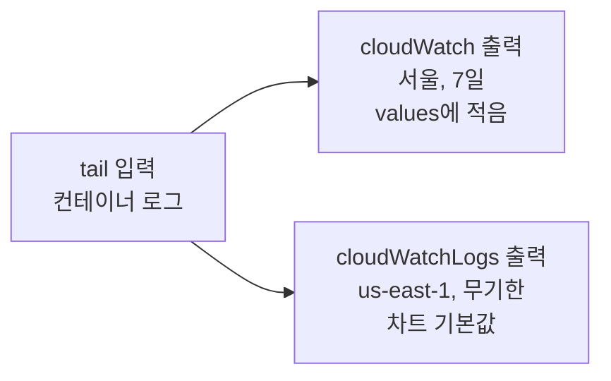

Kubernetes나 Lambda에서 로그를 CloudWatch로 보내고 있다면 로그 비용은 쌓아 둔 양이 아니라 들어오는 양이 정한다. 서울 리전에서 로그는 들어올 때 GB당 $0.76을 내고 저장은 압축된 크기로 GB-월당 $0.0314를 낸다. 나는 로그는 쌓아 둬도 얼마 안 나온다고 생각했다. 실제로 고쳐야 했던 것은 아무도 읽지 않는데 매일 들어오던 로그였다.

| | 이전 | 이후 |
|---|---|---|
| 클러스터 로그가 가는 곳 | 서울과 us-east-1 두 곳 (차트 기본값) | 서울 한 곳 |
| Lambda 로그 레벨 | DEBUG, 메시지 원문을 통째로 기록 | WARNING, 인입 약 92% 감소 |
| prod 애플리케이션 로그 인입 | 기준값 | 약 88% 감소 |
| 로그 보관 기간 | us-east-1 사본과 Lambda는 무기한 | 클러스터 7일, Lambda 30일 |

DevOps 담당자가 없는 팀에서 빠르게 개발하며 놓친 인프라를 비용 관점에서 되돌아봤다. 14가지 작업으로 월 약 $2,500을 줄였고 이 글은 그중 로그를 다룬다. 서비스가 안정되면서 로그를 자주 보지 않게 됐을 무렵, 무엇이 쌓이고 있는지 열어 봤다. 이 글에서는 같은 로그가 두 리전에 쌓이던 문제, Lambda가 DEBUG로 메시지 원문을 남기던 문제, 읽는 사람이 사라진 Python 로그를 고친 순서대로 정리한다.

## 로그 비용이 나가는 곳

CloudWatch Logs 요금은 크게 인입과 저장으로 나뉜다. 인입은 로그가 CloudWatch에 들어올 때 압축 전 크기로 GB마다 한 번 내는 요금이다. 저장은 보관 기간 동안 압축 후 크기로 매달 내는 요금이다. 가격 페이지의 저장 단가에는 "per GB compressed"라는 단서가 붙어 있다.

| 서울 리전 | 단가 | 기준 |
|---|---|---|
| 인입 | GB당 $0.76 | 압축 전 크기, 한 번 |
| 저장 | GB-월당 $0.0314 | 압축 후 크기, 매달 |

단가만 보면 인입이 저장의 24배다. 여기에 압축이 더해진다. 우리 로그 그룹에서는 들어온 로그 1 GB가 0.12~0.5 GB로 저장됐다. 가장 덜 압축된 그룹도 4년을 보관해야 저장비가 인입비와 같아진다.

#### 무기한으로 쌓아 두면 저장비가 커지지 않을까?

나는 보관 기간을 정하지 않은 로그 그룹이 비용의 주범일 거라고 생각했다. 그런데 보관 기간 없이 7개월 동안 쌓인 Lambda 로그 그룹을 보면 그 7개월 동안 낸 저장비는 같은 기간 인입비의 약 4%였다. 무기한 보관은 저장비가 가장 커질 수 있는 조건인데도 그랬다. 보관 기간을 줄이는 것은 이미 들어온 로그의 뒷정리다. 비용을 줄이려면 들어오는 양을 줄여야 한다.

비용을 잴 때는 로그 그룹마다 `IncomingBytes` 지표를 하루 단위로 뽑아 더했다. 이 값은 청구서의 인입 수량과 맞는다. 다만 청구서의 GB는 2^30 바이트(GiB)라서 지표를 10^9으로 나누면 7% 어긋나 보인다.

## 같은 로그가 두 리전에 쌓였다

클러스터 로그는 노드마다 하나씩 뜨는 fluent-bit 파드가 컨테이너 출력을 읽어 CloudWatch로 보낸다. fluent-bit은 AWS가 관리하는 `aws-for-fluent-bit` Helm 차트로 설치했다. 의도한 목적지는 서울 리전 로그 그룹 한 곳이었고 보관 기간은 7일이었다.

그런데 렌더된 설정에는 출력이 두 개 있었다. 하나는 values에 적은 서울행 출력이고 다른 하나는 values에 적지 않은 us-east-1행 출력이었다.



### 차트 기본값이 바뀐 버전

이 차트는 0.1.24에서 기본 출력을 바꿨다. 0.1.23까지는 `cloudWatch` 출력 하나만 있었는데 0.1.24부터 `cloudWatch`는 꺼지고 새 출력인 `cloudWatchLogs`가 기본으로 켜졌다. 이 출력의 기본 리전은 `us-east-1`이고 보관 기간은 비어 있어 무기한이다.

우리 values는 그 이전 버전의 공개 예제를 가져온 양식이었다. `cloudWatch` 블록에만 서울 리전을 적었고 `cloudWatchLogs` 블록은 없었다. 0.1.24로 설치한 첫날부터 모든 로그가 us-east-1에도 한 벌씩 쌓였다. prod에서는 약 33개월 동안 아무도 읽지 않는 이 사본이 있는 줄 몰랐다.

values에서 한 블록만 고쳤다.

```yaml
cloudWatchLogs:
  enabled: false
```

지금 최신 계열 차트도 같은 기본값을 쓴다. 이 차트를 쓴다면 values에 적은 출력이 아니라 렌더된 설정의 `[OUTPUT]`이 몇 개이고 어느 리전으로 가는지 확인해 봐야 한다.

### 출력을 꺼도 쌓인 로그는 남는다

출력을 끈 날부터 인입은 멈췄다. 하지만 이미 쌓인 사본은 무기한 보관이라 저장 요금이 계속 붙었다. 인입을 끊은 다음 달에도 us-east-1 저장 요금은 20%만 줄었다.

그래서 사본 로그 그룹을 지웠다. 지우기 전에 그룹마다 구독 필터와 지표 필터가 하나도 없는지, 출력을 끈 뒤 들어온 로그가 없는지 확인했다. 그룹 이름이 클러스터가 아니라 네임스페이스 이름이라 다른 클러스터의 로그와 섞일 수 있었다. 우리 것인지는 로그 스트림 이름에 들어 있는 컨테이너 이름으로 판정했다. 이 건에서 줄어든 비용의 80%는 인입, 20%는 저장이었다.

### 출력 하나가 막히자 다른 출력도 멈췄다

사본을 찾게 된 계기는 비용이 아니었다. prod 노드 하나의 로그가 서울 로그 그룹에서 31일 동안 비어 있었다. 그 노드의 fluent-bit 파드는 Running, Ready, 재시작 0회로 멀쩡해 보였다.

원인은 입력 하나를 출력 두 개가 나눠 쓰는 구조였다. us-east-1 출력이 멈추자 메모리 버퍼가 `Mem_Buf_Limit` 5 MB에 닿았고 fluent-bit은 버퍼가 빌 때까지 입력을 멈췄다. 입력이 멈추니 정상이던 서울 출력에도 새 로그가 가지 않았다. us-east-1 출력이 멈춘 이유는 `cloudwatch_logs` 플러그인의 멈춤 결함으로 보인다. 당시 이미지 버전에 이 결함이 있었지만 원본 로그가 남아 있지 않아 단정할 수는 없다.

차트 0.1.24에는 liveness probe도 readiness probe도 없었다. kubelet은 프로세스가 살아 있다는 것만 보고 파드를 Ready로 두었다. 차트를 0.1.35로 올리면서 버퍼를 파일 시스템으로 바꿔 출력 하나가 막혀도 입력이 멈추지 않게 했다. Health_Check와 liveness probe도 붙였다. 다만 Health_Check는 에러 없이 조용히 멈추는 경우를 잡지 못한다. 이런 정지는 파드 상태가 아니라 로그 그룹의 인입량이 끊겼는지로 봐야 알 수 있다.

## Lambda가 메시지 원문을 DEBUG로 남겼다

로그 그룹을 리전 전체에서 `IncomingBytes` 순으로 정렬해 보니 클러스터 로그 다음에 Lambda 함수 하나가 있었다. 이 함수는 앱 서버가 큐에 넣은 API 호출 기록과 백그라운드 작업 기록을 받아 로그 전용 DB에 저장한다. 같은 24시간 동안 이 함수 하나가 남긴 로그가 prod 클러스터 전체의 90%에 가까웠다.

처음에 이 함수를 보지 못한 이유는 셋이었다. 조사 범위를 클러스터 로그 그룹으로 잡았다. Lambda 로그 그룹에는 서비스 태그가 없어 태그로 거른 청구서에서 빠졌다. Lambda 로그는 2025년 5월부터 vended logs로 분류돼 청구서의 다른 줄에 잡힌다. 서울 리전의 첫 구간 단가는 $0.76으로 같고 청구서 줄만 달랐다.

### Zappa 기본값 두 개가 겹쳤다

이 함수는 Zappa로 배포한다. Zappa에는 로그와 관련된 기본값이 두 개 있다. `debug`는 기본값이 `true`다. 켜져 있으면 핸들러가 들어온 이벤트 전체를 `Zappa Event: {...}` 형태로 DEBUG 로그에 남긴다. `log_level`은 기본값이 `DEBUG`이고 Zappa 로거와 함께 root 로거의 레벨도 이 값으로 맞춘다.

우리 `zappa_settings.json`에는 두 키가 처음부터 없었다. 그래서 SQS 메시지 본문이 들어 있는 이벤트 전체가 호출마다 DEBUG로 남았고 반환값도 한 줄 더 남았다. 설정 파일에 `DEBUG: "False"` 환경 변수가 있었지만 이 변수는 Django 설정이라 Zappa의 `debug`와는 상관이 없었다.

고친 것은 스테이지마다 한 줄이다.

```json
{
  "<stage>": {
    "log_level": "WARNING"
  }
}
```

### 줄 수보다 줄의 크기가 비용이었다

고친 뒤 줄 수는 64% 줄었는데 바이트는 약 92% 줄었다. DEBUG 줄은 줄 수로는 3분의 1이었지만 바이트로는 87%였다. 줄당 크기가 약 560 B에서 114 B로 줄었다. 메시지 원문을 통째로 찍는 로그는 줄 하나하나가 비싸다.

CRITICAL이 아니라 WARNING으로 올린 이유는 남은 ERROR와 WARNING 때문이다. 둘을 합쳐도 하루 0.09 MB였지만 기록이 DB에 저장되지 못한 파싱 실패를 알려 주는 유일한 신호였다. 레벨을 CRITICAL로 올려도 절감률은 반올림 오차 정도밖에 차이 나지 않았다.

이 Lambda 로그 그룹은 보관 기간도 무기한이었다. Zappa는 로그 그룹을 만들지 않고 Lambda가 첫 실행 때 그룹을 만들면서 보관 기간을 비워 둔다. 보관 기간은 Terraform으로 30일로 고정했다. 앞에서 본 것처럼 이 그룹에서 7개월 동안 낸 저장비는 인입비의 약 4%였다. 보관 기간을 정한 것보다 로그 레벨 한 줄이 훨씬 컸다.

## 읽는 사람이 사라진 Python 로그

클러스터 로그에서 가장 큰 몫은 Django API 서버와 Celery 워커의 로그였다. 개발 초기에 나는 작업이 잘 실행되는지, 실패하면 어떤 오류인지 보려고 로그를 남겼다. 그때는 실제로 읽는 로그였다. 서비스가 안정되면서 아무도 읽지 않게 됐지만 로그는 그대로 남아 매일 들어오고 있었다. 정리하기 전 하루 로그에서 "ERROR"라는 문자열이 들어간 줄은 약 4만 줄에 한 줄꼴이었다.

### 줄 하나의 87%는 메타데이터였다

클러스터 로그는 줄 수가 비용을 정한다. fluent-bit의 Kubernetes 필터가 줄마다 파드 이름, 네임스페이스, 컨테이너 해시, 이미지, 라벨, 어노테이션을 붙이기 때문이다. 줄 하나는 CloudWatch에 약 1,300 B로 들어간다. 그중 실제 메시지는 100~200 B이고 나머지 약 1,100 B는 메타데이터였다.

메시지를 짧게 고치는 것보다 줄을 없애는 것이 훨씬 효과가 크다. 정리하는 동안 줄 수가 90% 줄어도 줄당 크기는 약 1,280 B 그대로였다. Lambda와는 반대다. Lambda는 메타데이터가 붙지 않아 메시지 크기가 비용을 정했다.

### 많이 나오던 로그

정리하기 전 api와 워커 로그를 패턴별로 세어 보니 상위 몇 개가 대부분이었다.

| 로그 | 처리 |
|---|---|
| 푸시 알림을 대상 한 명마다 한 줄씩 기록 (전체 줄의 약 20%) | 발송 회차마다 집계 한 줄 |
| 락을 못 잡아 재시도할 때마다 세 줄 (약 16%) | 삭제. 경합은 큐 지표로 본다 |
| httpx가 HTTP 요청마다 남기는 INFO (약 15%) | httpx 로거를 WARNING으로 |
| Celery가 우리 로그를 자기 형식으로 한 번 더 기록 | 우리 로거의 전파를 끊음 |
| dict와 리스트를 통째로 덤프 | 삭제 |
| 배치 진행률을 건마다 기록 | 배치가 끝날 때 요약 한 줄 |

대부분 개발 초기에 실행을 확인하려고 남긴 로그다. 성공을 건마다 남기던 로그는 집계나 지표로 바꾸고 실패를 가리키는 로그는 건마다 남겼다. 실제로 억제하려던 예외 몇 가지는 프런트엔드가 ID 자리에 `null`을 보내는 것 같은 진짜 결함을 가리키고 있어서 그대로 남겼다.

### Django 로깅 설정 한 곳에 결함 세 개

api 로그가 많았던 이유는 로그를 많이 찍어서가 아니라 `LOGGING` 설정 한 곳에 결함 세 개가 겹쳐 있었기 때문이다. 세 결함은 `LOGGING` 블록을 처음 만든 커밋 하나로 함께 들어와 2년 동안 남아 있었다.

```python
LOGGING = {
    "handlers": {"console": {"class": "logging.StreamHandler", "level": "DEBUG"}},
    "loggers": {
        "<APP_LOGGER>": {
            "handlers": ["console"],
            "level": os.getenv("DJANGO_LOG_LEVEL", "DEBUG"),
            "formatter": "verbose",
            "propagate": True,
        },
    },
}
```

첫째, 모든 앱 로그가 두 번씩 기록됐다. Python 로거는 자기 핸들러를 부른 뒤 `propagate`가 참이면 부모 로거의 핸들러도 부른다. 코드 곳곳의 모듈 수준 `logging.info()` 호출이 root에 기본 핸들러를 붙여 두었기 때문에 같은 레코드가 앱 로거의 핸들러와 root 핸들러로 한 번씩 나갔다. 설정 옆 주석은 "root 로거와의 이중 기록을 막으려면 필요하다"였는데 실제로는 이중 기록의 원인이었다.

둘째, prod가 DEBUG로 돌고 있었다. Django 문서의 예제는 `os.getenv("DJANGO_LOG_LEVEL", "INFO")`인데 우리 코드는 기본값만 `"DEBUG"`로 바뀌어 있었다. 배포 values에는 `DJANGO_LOG_LEVEL`이 아예 없어서 이 기본값이 그대로 적용됐다. 워커는 처음부터 기본값이 INFO라 이 문제가 없었다.

셋째, 포맷터가 붙어 있지 않았다. `formatter`를 핸들러가 아니라 로거 항목에 적었다. `dictConfig`는 로거 항목에서 `level`, `handlers`, `filters`, `propagate`만 읽고 나머지 키는 보지 않는다. 그래서 오류 없이 넘어갔고 api 로그에는 레벨도 로거 이름도 없이 메시지만 찍혔다. 레벨로 로그를 거를 수조차 없었다. 핸들러 항목에 모르는 키를 적었다면 생성자 인자로 넘어가 바로 `TypeError`가 났을 것이다.

고친 뒤의 설정은 이렇다. 포맷터를 핸들러로 옮기고 앱 로거의 전파를 끊었다. root를 명시하고 레벨 기본값을 INFO로 바꿨다. 배포 values에도 `DJANGO_LOG_LEVEL`을 넣었다.

```python
"handlers": {"console": {"class": "logging.StreamHandler",
                         "level": os.getenv("DJANGO_LOG_LEVEL", "INFO"),
                         "formatter": "verbose"}},
"loggers": {
    "<APP_LOGGER>": {"handlers": ["console"],
                     "level": os.getenv("DJANGO_LOG_LEVEL", "INFO"),
                     "propagate": False},
    "httpx": {"level": "WARNING"},
    "celery.worker.strategy": {"level": "WARNING"},
    "celery.app.trace": {"level": "WARNING"},
},
"root": {"handlers": ["console"], "level": "WARNING"},
```

### Celery 로그는 로거 단위로 줄인다

Celery 워커는 태스크를 받을 때와 끝낼 때마다 한 줄씩 남긴다. 이 내용은 태스크 기록을 저장하는 DB에 거의 1:1로 이미 들어가 있었다. 앞에서 본 Lambda가 바로 그 DB를 채우는 함수다. 그래서 두 줄을 남기는 `celery.worker.strategy`와 `celery.app.trace` 로거를 WARNING으로 올렸다.

처음에는 `celery` 로거 전체에 `propagate: False`를 걸었다가 Celery 로그가 모두 사라졌다. Celery 워커는 기동할 때 `worker_hijack_root_logger`가 켜져 있으면 root와 `celery`, `celery.task`, `celery.redirected` 로거의 핸들러를 모두 비운다. 공식 문서에는 root만 적혀 있고 나머지는 소스 코드에만 있다. 핸들러가 비워진 로거에서 전파까지 끊으면 레코드가 갈 곳이 없다. 워커 실행 옵션을 `-l info`에서 `-l warning`으로 바꾸면 브로커 연결과 기동 완료 같은 INFO 로그까지 함께 사라져서 이 방법도 쓸 수 없었다.

### 남긴 로그

모든 반복 로그를 지우지는 않았다. 스케줄러가 주기 작업을 보낼 때 남기는 `Scheduler: Sending due task` 줄은 남겼다. 이 줄에 대응하는 DB 기록이 없어서 브로커가 메시지를 잃었을 때 알아챌 수 있는 유일한 증거다. 메시지 큐 소비와 발행을 기록하는 줄도 남겼다. CloudWatch 지표 필터가 이 줄을 세고 그 위에 "1건 미만이면 경보, 데이터가 없어도 경보"인 알람이 걸려 있기 때문이다.

정리하고 나니 남길지 지울지를 가른 기준은 네 가지였다.

- 다른 저장소에 같은 정보가 있으면 지운다.
- 유일한 증거면 남긴다.
- 알람이 물려 있으면 건드리지 않는다.
- 관측할 가치가 있으면 건마다 남기던 줄을 집계로 바꾸되 읽을 사람이 없는 집계는 만들지 않는다.

마지막 기준 때문에 접은 안도 있다. 락 재시도 로그를 파드마다 60초에 한 줄씩 집계하려 했다. 그러면 아무도 읽지 않을 줄이 하루 17,280개 새로 생겨서 그만두고 큐 지표로 보기로 했다.

로그 수집에 쓰는 Loki와 배포에 쓰는 Argo CD도 각자 기본값인 info 레벨로 하우스키핑 로그를 내고 있었다. 둘 다 warn으로 올렸다. Argo CD 차트는 컴포넌트별 `logLevel` 키가 아니라 `configs.params`의 `<컴포넌트>.log.level`로 바꿔야 실제로 반영된다.

### 메타데이터는 줄이지 않았다

줄마다 붙는 메타데이터를 줄이는 방법도 검토했다. fluent-bit Kubernetes 필터에서 라벨과 어노테이션만 꺼도 줄당 약 33%가 준다. 하지만 수집기는 다른 팀의 네임스페이스와 같이 쓰고 라벨로 거르는 기존 조회와 대시보드가 깨질 수 있었다. 줄 수를 90% 줄이면 바이트도 같은 비율로 줄어드니 줄 수부터 처리하기로 했다. 메타데이터는 아직 그대로다.

## 결과

prod의 api와 워커 로그 인입은 평일 기준 약 88%, staging은 약 85% 줄었다. us-east-1 사본은 인입과 저장 모두 0이 됐고 Lambda 로그 인입은 약 92% 줄었다.

7주 뒤 다시 재 보니 prod 인입은 정리 직후보다 17% 늘어 있었다. 정리한 로그가 돌아온 것은 아니었다. staging에서 돌던 처리 하나가 prod로 옮겨 오면서 처리 한 건마다 단계별 INFO를 수십 줄씩 남기고 있었다. 이 처리 하나가 워커 로그의 40%였다. 한 번 정리해도 새 코드와 함께 새 로그가 계속 들어온다.

## 정리

세 건은 원인이 달랐다. us-east-1 사본은 values에 적지 않은 Helm 차트 기본값 때문이었다. Lambda의 원문 덤프는 설정 파일에 없던 배포 도구 기본값 두 개 때문이었다. Python 로그는 개발 초기에 필요해서 남겼다가 읽는 사람이 사라진 뒤 다시 보지 않은 로그였다. 비용을 키운 것도 각각 출력 개수, 메시지 크기, 줄 수로 달랐다.

그래도 셋 다 인입이 문제였다. 나는 로그는 쌓아 둬도 얼마 안 나온다고 생각했고 그 생각은 맞았다. 저장은 압축된 크기로 싸게 과금된다. 하지만 로그 비용이 쌓아 둔 데서 나온다는 생각은 틀렸다. 보관 기간보다 무엇이 매일 들어오고 그것을 누가 읽는지를 먼저 보기를 권한다.

## 참고

- [Amazon CloudWatch 요금](https://aws.amazon.com/cloudwatch/pricing/)
- [CloudWatch Logs 로그 클래스](https://docs.aws.amazon.com/AmazonCloudWatch/latest/logs/CloudWatch_Logs_Log_Classes.html)
- [AWS Lambda introduces tiered pricing for Amazon CloudWatch logs](https://aws.amazon.com/blogs/compute/aws-lambda-introduces-tiered-pricing-for-amazon-cloudwatch-logs-and-additional-logging-destinations/)
- [aws/eks-charts #903: aws-for-fluent-bit 기본 출력을 cloudwatch_logs로 변경](https://github.com/aws/eks-charts/pull/903)
- [aws/aws-for-fluent-bit #542: CloudWatch Hang Issue](https://github.com/aws/aws-for-fluent-bit/issues/542)
- [Fluent Bit: Backpressure](https://docs.fluentbit.io/manual/administration/backpressure)
- [Python logging: Logger.propagate](https://docs.python.org/3.12/library/logging.html#logging.Logger.propagate)
- [Django: Logging](https://docs.djangoproject.com/en/5.2/topics/logging/)
- [Celery: worker_hijack_root_logger](https://docs.celeryq.dev/en/v5.6.3/userguide/configuration.html#worker-hijack-root-logger)
