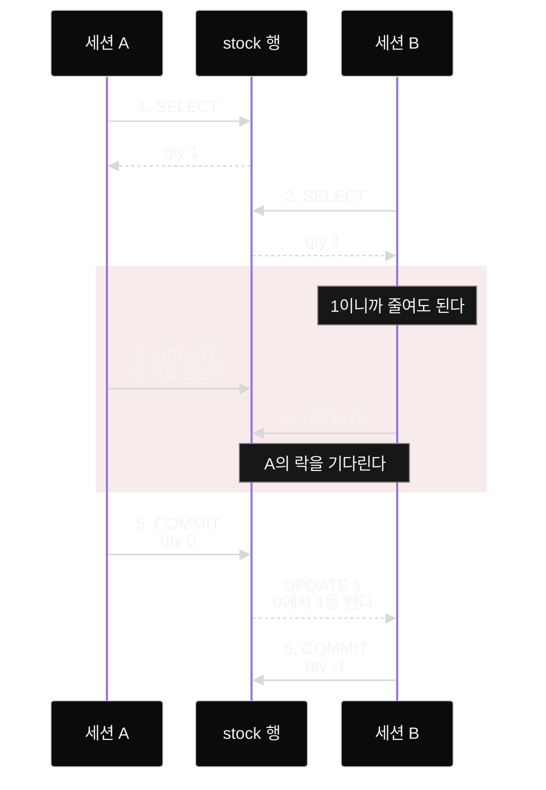

ORM으로 트랜잭션과 락은 써 봤지만 `BEGIN`과 `COMMIT`을 SQL로 직접 쳐 본 적은 없는 개발자를 위한 글이다. 재고가 1개인 상품에 주문 두 건이 동시에 들어오는 상황을 psql 창 두 개로 세 번 재현하고 그때마다 두 트랜잭션이 무엇을 보고 언제 멈추는지 기록했다. 세 실험 모두에 행 락이 있었지만 재고가 -1이 된 실험이 하나 있었다. 결과를 가른 것은 재고를 확인한 순간과 줄이는 순간 사이에 다른 트랜잭션이 끼어들 틈이 있었느냐였다.

| 실험 | 재고를 확인하는 곳 | 락이 잡히는 때 | 마지막 재고 |
|---|---|---|---|
| 1. 읽은 값을 보고 줄이기 | 앱 (`SELECT` 결과를 보고) | 줄일 때 | -1 |
| 2. 읽을 때 락 잡기 | 앱 (`SELECT … FOR UPDATE` 결과를 보고) | 읽을 때 | 0 |
| 3. 확인을 `UPDATE` 안에 넣기 | DB (`WHERE qty > 0`) | 줄일 때 | 0 |

계기는 내가 쓴 코드였다. 검색 색인을 transactional outbox로 옮기면서 만든 relay는 `SELECT … FOR UPDATE`로 처리할 행을 가져온다. 그런데 재고 1개에 주문 두 건이 동시에 들어오면 어떻게 막느냐고 스스로 물었을 때 나는 "행에 락을 건다", "줄일 때 거는 것 같다"까지만 답할 수 있었다.

락이 언제 잡히는지, 기다리던 트랜잭션이 풀린 뒤 무엇을 보는지는 확인해 본 적이 없었다. 이 글에서는 세 실험의 순서와 결과, 그 결과를 설명하는 트랜잭션·행 락·격리 수준의 기본 동작을 정리한다.

## 실험 환경

로컬에 PostgreSQL 18 컨테이너를 띄우고 재고 테이블에 행 하나를 넣었다.

```bash
docker run -d --name pg-lab -e POSTGRES_PASSWORD=postgres -p 127.0.0.1:5432:5432 postgres:18
```

```sql
CREATE TABLE stock (id int PRIMARY KEY, qty int);
INSERT INTO stock VALUES (1, 1);
```

터미널 두 개에서 `docker exec -it pg-lab psql -U postgres`로 접속해 하나는 세션 A, 다른 하나는 세션 B로 썼다. 실제 서비스라면 앱 코드가 재고를 확인하겠지만 실험에서는 내가 `SELECT` 결과를 눈으로 보고 1 이상이면 줄이기로 했다.

### 트랜잭션과 행 락

트랜잭션은 `BEGIN`부터 `COMMIT`까지 실행한 문장을 한 묶음으로 처리하는 단위다. 묶음 안에서 바꾼 값은 `COMMIT`으로 확정하기 전까지 다른 세션에 보이지 않고 `ROLLBACK`하면 없던 일이 된다. psql은 트랜잭션 안에 있을 때 프롬프트를 `postgres=#`에서 `postgres=*#`로 바꿔 보여 준다.

`UPDATE`로 행을 바꾸면 그 행에 락이 걸리고 트랜잭션이 끝날 때까지 유지된다. 다른 트랜잭션이 같은 행을 바꾸려 하면 락이 풀릴 때까지 멈춰서 기다린다. 평범한 `SELECT`는 락을 잡지 않고 다른 트랜잭션의 락 때문에 기다리지도 않는다. `SELECT … FOR UPDATE`는 읽는 순간 그 행에 락을 잡아서 다른 트랜잭션의 `UPDATE`나 `FOR UPDATE`를 기다리게 만든다.

### 격리 수준

격리 수준은 동시에 실행되는 트랜잭션이 서로가 바꾼 내용을 언제부터 보는지 정하는 설정이다. PostgreSQL의 기본값은 READ COMMITTED이고 컨테이너에서 `SHOW default_transaction_isolation;`을 실행하면 `read committed`가 나온다. 이 수준에서는 문장마다 그 문장이 시작되기 전에 커밋된 데이터를 본다. 이 글의 실험은 모두 이 기본값에서 했다.

## 읽은 값을 보고 줄이기

가장 먼저 떠오르는 순서대로 했다. 두 세션이 재고를 읽고 1이니까 각자 1을 줄인다.

```sql
-- 1. A
BEGIN;
SELECT qty FROM stock WHERE id = 1;              -- qty 1
-- 2. B
BEGIN;
SELECT qty FROM stock WHERE id = 1;              -- qty 1
-- 3. A
UPDATE stock SET qty = qty - 1 WHERE id = 1;     -- UPDATE 1
-- 4. B
UPDATE stock SET qty = qty - 1 WHERE id = 1;     -- 결과가 나오지 않고 멈춘다
-- 5. A
COMMIT;                                          -- 이 순간 B에 UPDATE 1이 뜬다
-- 6. B
COMMIT;
SELECT qty FROM stock;                           -- qty -1
```

마지막에 본 재고는 -1이었다. 재고 1개를 두 번 판 것이다.



B는 4번에서 멈췄다. A가 3번 `UPDATE`에서 잡은 행 락 때문이다. 락은 분명히 있었다. 문제는 B가 줄여도 된다고 판단한 시점이 그보다 앞선 2번이었다는 것이고 2번과 4번 사이에는 B가 읽은 행을 지켜 주는 것이 없었다.

A가 커밋하자 B의 `UPDATE`가 이어서 실행됐다. `qty = qty - 1`의 `qty`는 2번에서 읽어 둔 값이 아니라 `UPDATE`가 실행되는 순간 행에 있는 값이다. 그 값은 A가 줄여 둔 0이었고 B는 0에서 1을 뺐다. 처음 읽을 때 값과 빼려고 한 지금 값이 달랐던 것이다.

### 줄일 때 락을 걸면 되지 않을까?

실험 전 내 답이 이것이었다. 그런데 실험 1은 이미 그렇게 동작했다. `UPDATE`는 줄일 때 락을 잡았고 B는 실제로 기다렸다. 락이 판단보다 늦게 걸리면 B는 기다렸다가 이미 끝난 판단대로 실행할 뿐이다.

## 읽을 때 락 잡기

1번과 2번의 `SELECT` 끝에 `FOR UPDATE`만 붙였다. 순서는 B가 멈추는 위치에 맞춰 조금 바뀌었다.

```sql
-- 1. A
BEGIN;
SELECT qty FROM stock WHERE id = 1 FOR UPDATE;   -- qty 1, 행 락을 잡는다
-- 2. B
BEGIN;
SELECT qty FROM stock WHERE id = 1 FOR UPDATE;   -- 결과가 나오지 않고 멈춘다
-- 3. A
UPDATE stock SET qty = qty - 1 WHERE id = 1;     -- UPDATE 1
-- 4. A
COMMIT;                                          -- 이 순간 B에 qty 0이 뜬다
-- 5. B: 0이니까 줄이지 않는다
COMMIT;
-- 6.
SELECT qty FROM stock;                           -- qty 0
```

실행하기 전에 세 가지를 예측했다. B는 2번에서 멈추고 락이 풀리면 0을 보고 줄이지 않으니 마지막 재고는 0이다. 셋 다 맞았다.

이번에는 B가 판단하려고 읽는 순간부터 기다렸다. A가 커밋한 뒤 B의 `SELECT`가 돌려준 값은 A가 커밋한 0이었다. READ COMMITTED에서 락을 기다리던 문장은 락이 풀리면 그 행의 바뀐 값을 가지고 계속 진행한다.

실험 2에도 재고를 확인하는 SQL은 없다. 확인은 여전히 앱, 이번에는 내 눈이 했다. 실험 1과 다른 점은 확인하는 동안 `FOR UPDATE`가 그 행을 지켜 준다는 것 하나다.

## 확인을 UPDATE 안에 넣기

이번에는 따로 읽지 않았다. "재고가 1 이상이면"이라는 확인을 `UPDATE`의 `WHERE`에 넣었다.

```sql
-- 1. A
BEGIN;
-- 2. B
BEGIN;
-- 3. A
UPDATE stock SET qty = qty - 1 WHERE id = 1 AND qty > 0;   -- UPDATE 1
-- 4. B
UPDATE stock SET qty = qty - 1 WHERE id = 1 AND qty > 0;   -- 결과가 나오지 않고 멈춘다
-- 5. A
COMMIT;                                                    -- 이 순간 B에 UPDATE 0이 뜬다
-- 6. B
COMMIT;
-- 7.
SELECT qty FROM stock;                                     -- qty 0
```

B는 실험 1처럼 4번 `UPDATE`에서 멈췄다. 락이 잡힌 때도 실험 1과 같은 줄일 때다. 그런데 B가 받은 결과는 `UPDATE 0`이었고 마지막 재고는 0이었다.

`UPDATE 0`은 조건에 맞는 행이 없어서 하나도 바꾸지 않았다는 뜻이다. READ COMMITTED에서 락을 기다리던 `UPDATE`는 락이 풀리면 바뀐 행을 가지고 `WHERE` 조건을 다시 확인한다. B는 A가 커밋한 0으로 `qty > 0`을 확인했고 거짓이었다. B는 재고를 A의 커밋이 된 후의 값으로 판단한 것이다.

실험 1과 3은 락이 잡힌 때가 같은데 결과가 다르다. 차이는 판단이 어디 있었느냐다. 실험 1에서는 판단이 락보다 앞선 2번에 있었고 실험 3에서는 판단이 락을 잡는 문장 안에 있었다.

## 격리 수준을 바꾸면

세 실험의 결과는 READ COMMITTED에서 나왔다. 기다리던 트랜잭션이 풀린 뒤 바뀐 값을 가지고 계속 진행하는 것이 이 수준의 규칙이기 때문이다. PostgreSQL 문서에 따르면 REPEATABLE READ에서는 B가 0을 보는 대신 `could not serialize access due to concurrent update` 오류를 받고 앱이 트랜잭션을 처음부터 다시 시도해야 한다. 격리 수준별 차이는 이 글에서 더 다루지 않는다.

## 정리

재고 1개에 주문 두 건이 동시에 들어오는 상황을 세 번 재현했다. 행 락은 세 실험 모두에 있었다. 재고가 -1이 된 것은 판단과 락 사이에 틈이 있던 실험 1뿐이었다.

실험 전에 나는 "줄일 때 락을 건다"고 답했다. 반은 맞았다. 확인까지 같은 `UPDATE` 문장에 넣으면 줄일 때 잡는 락으로 충분하다. 확인을 앱에서 따로 한다면 락은 읽을 때부터 잡아야 한다.

이 글은 판단에 재고 한 행만 필요한 경우를 다뤘다. 1인당 구매 한도처럼 다른 테이블을 함께 봐야 하거나, 결제 API 호출처럼 락을 쥔 시간이 길어지거나, 한정판 1,000개에 10만 명이 몰리면 고를 방법이 달라진다. 이 경우들은 다음 글에서 하나씩 실험한다.

재고를 확인한 순간부터 줄이는 순간까지 다른 트랜잭션이 그 행을 바꿀 수 없어야 한다.

## 참고

- [PostgreSQL 18 문서: Transaction Isolation](https://www.postgresql.org/docs/18/transaction-iso.html)
- [PostgreSQL 18 문서: Explicit Locking](https://www.postgresql.org/docs/18/explicit-locking.html)
- [PostgreSQL 18 문서: SELECT의 locking clause](https://www.postgresql.org/docs/18/sql-select.html#SQL-FOR-UPDATE-SHARE)
