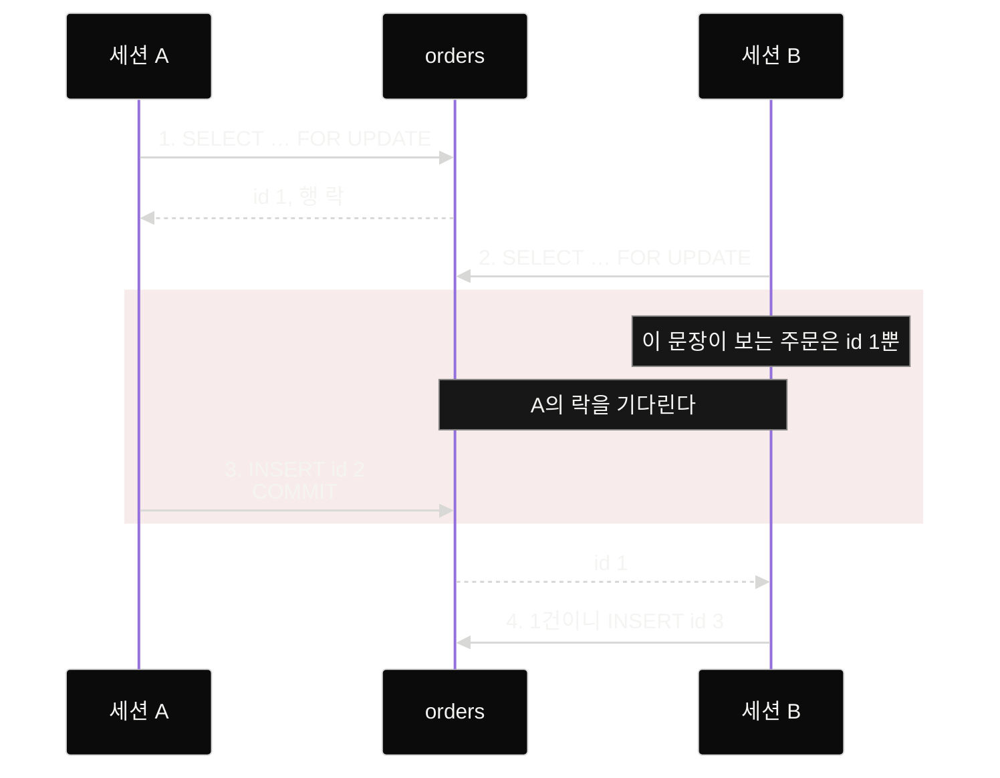

[1편](/posts/stock-row-lock-experiments)에서는 재고 1개에 주문 두 건이 동시에 들어와도 재고가 음수가 되지 않는 방법을 확인했다. 재고를 읽을 때 `SELECT … FOR UPDATE`로 락을 잡거나 확인을 `UPDATE … WHERE qty > 0` 안에 넣으면 됐다. 두 방법 모두 판단에 필요한 값이 재고 행 하나에 있었다.

이번에는 상품에 1인당 2개라는 구매 한도를 붙였다. 판단에 고객이 이미 산 개수가 필요하고 그 값은 재고 행이 아니라 주문 테이블에 있다. 같은 고객의 주문 두 건을 동시에 실행했더니 네 실험 중 두 번은 한도를 넘겨 주문이 3건 들어갔다. 결과를 가른 것은 무엇을 잠갔느냐와 주문 수를 락보다 먼저 읽었느냐였다.

| 실험 | 먼저 잠근 행 | 주문 수를 읽은 때 | 고객의 주문 |
|---|---|---|---|
| 1. 주문 행 먼저 잠그기 (SQL) | 그 고객의 주문 행 | 락을 기다린 바로 그 문장에서 | 3건 |
| 2. 재고 행 먼저 잠그기 (SQL) | 재고 행 | 락을 잡은 뒤 새 문장으로 | 2건 |
| 3. 실험 2를 Django ORM으로 | 재고 행 | 락을 잡은 뒤 | 2건 |
| 4. 실험 3에서 두 줄 순서 바꾸기 | 재고 행 | 락을 잡기 전 | 3건 |

이 글에서는 이 상황을 psql 실험 두 개와 Django ORM 실험 두 개로 재현하고 결과를 설명하는 트랜잭션과 락의 차이, READ COMMITTED에서 읽기의 기준이 되는 시점을 정리한다.

## 실험 환경

1편에서 띄운 PostgreSQL 18 컨테이너(`pg-lab`)에 `shop` 데이터베이스를 새로 만들었다. 테이블은 Django 모델로 정의하고 마이그레이션으로 만들었다. Django는 같은 도커 네트워크에 붙인 `python:3.13-slim` 컨테이너에서 실행했다(Django 5.2, psycopg 3).

```python
class Customer(models.Model):
    name = models.CharField(max_length=50)

    class Meta:
        db_table = "customer"


class Stock(models.Model):
    qty = models.IntegerField()

    class Meta:
        db_table = "stock"


class Order(models.Model):
    customer = models.ForeignKey(Customer, on_delete=models.PROTECT)
    stock = models.ForeignKey(Stock, on_delete=models.PROTECT)

    class Meta:
        db_table = "orders"
```

모든 실험은 같은 상태에서 시작했다. 재고는 10개로 넉넉하고 고객 7은 이 상품을 이미 1개 샀다. 한도가 2개이니 고객 7은 1개만 더 살 수 있다.

```sql
INSERT INTO customer (id, name) VALUES (7, 'c7');
INSERT INTO stock (id, qty) VALUES (1, 10);
INSERT INTO orders (customer_id, stock_id) VALUES (7, 1);
```

psql 창 두 개를 `docker exec -it pg-lab psql -U postgres -d shop`으로 열어 세션 A와 B로 썼다. 판단은 1편처럼 사람이 한다. 고객 7의 주문이 2건 미만이면 재고를 줄이고 주문을 넣는다.

## 트랜잭션과 락

트랜잭션은 여러 문장을 한 묶음으로 처리하는 단위다. `BEGIN`부터 `COMMIT`까지 실행한 문장은 모두 반영되거나 모두 취소되고 다른 세션에는 `COMMIT`하는 순간 한꺼번에 보인다. 트랜잭션이 하지 않는 일도 있다. 다른 세션이 같은 행을 읽는 것을 막지 않고 내가 읽은 값이 그 사이에 바뀌지 않게 지켜 주지도 않는다.

락은 행을 잡아 두는 장치다. 한 트랜잭션이 어떤 행에 락을 잡으면 다른 트랜잭션은 그 행을 바꾸거나 같은 락을 잡으려 할 때 기다린다. 락을 잡는 문장은 정해져 있다. `UPDATE`와 `DELETE`는 바꾸는 행을 자동으로 잠그고 `SELECT … FOR UPDATE`는 읽은 행을 `UPDATE`와 같은 방식으로 잠근다. 평범한 `SELECT`는 락을 잡지 않고 다른 트랜잭션이 잡은 락 때문에 기다리지도 않는다.

둘은 따로 움직이지 않는다. 락은 트랜잭션 안에서 잡히고 그 트랜잭션이 끝날 때 풀린다. `BEGIN` 없이 `UPDATE` 하나만 실행하면 그 문장이 곧 하나의 트랜잭션이 되고 락도 문장이 끝나는 순간 풀린다. 트랜잭션은 락을 얼마나 오래 쥘지를, 락은 그동안 누구를 기다리게 할지를 정한다.

| | 트랜잭션 | 락 |
|---|---|---|
| 만드는 문장 | `BEGIN` … `COMMIT` / `ROLLBACK` | `UPDATE`, `DELETE`, `SELECT … FOR UPDATE` |
| 하는 일 | 여러 문장을 함께 반영하거나 함께 취소한다 | 같은 행을 바꾸거나 잠그려는 다른 트랜잭션을 기다리게 한다 |
| 막지 못하는 것 | 다른 세션의 읽기, 읽은 값이 그 사이 바뀌는 것 | 평범한 `SELECT` |
| 끝나는 때 | `COMMIT` / `ROLLBACK` | 락을 잡은 트랜잭션이 끝날 때 |

차이는 두 줄짜리 실험으로 볼 수 있다. A는 트랜잭션을 열고 재고를 읽기만 하고 B는 `BEGIN` 없이 재고를 줄인다.

```sql
-- 1. A
BEGIN;
SELECT qty FROM stock WHERE id = 1;              -- qty 10
-- 2. B
UPDATE stock SET qty = qty - 1 WHERE id = 1;     -- 바로 UPDATE 1
-- 3. A
COMMIT;
```

A의 트랜잭션이 열려 있었지만 B는 기다리지 않았다. 트랜잭션을 열고 읽기만 해서는 아무 행도 잠기지 않는다. 1번의 `SELECT`에 `FOR UPDATE`만 붙여 다시 실행하면 결과가 달라진다.

```sql
-- 1. A
BEGIN;
SELECT qty FROM stock WHERE id = 1 FOR UPDATE;   -- qty 9, 행 락을 잡는다
-- 2. B
UPDATE stock SET qty = qty - 1 WHERE id = 1;     -- 결과가 나오지 않고 멈춘다
-- 3. A
COMMIT;                                          -- 이 순간 B에 UPDATE 1이 뜬다
```

Django에서는 `transaction.atomic()` 블록이 `BEGIN`과 `COMMIT`이고 `select_for_update()`가 `FOR UPDATE`다. `atomic()` 밖에서 `select_for_update()`를 실행하면 Django는 `TransactionManagementError: select_for_update cannot be used outside of a transaction.`를 낸다. 트랜잭션이 없으면 락은 문장이 끝나자마자 풀리므로 잡는 의미가 없기 때문이다.

## 주문 행을 먼저 잠그기

판단에 쓰는 값은 고객 7의 주문 수다. 그래서 먼저 떠오르는 방법은 그 주문 행을 `FOR UPDATE`로 잠그고 개수를 보는 것이다.

```sql
-- 1. A
BEGIN;
SELECT id FROM orders WHERE customer_id = 7 AND stock_id = 1 FOR UPDATE;   -- id 1, 행 락을 잡는다
-- 2. B
BEGIN;
SELECT id FROM orders WHERE customer_id = 7 AND stock_id = 1 FOR UPDATE;   -- 결과가 나오지 않고 멈춘다
-- 3. A: 1건이니 한도 안이다
UPDATE stock SET qty = qty - 1 WHERE id = 1;                               -- UPDATE 1
INSERT INTO orders (customer_id, stock_id) VALUES (7, 1);                  -- id 2
COMMIT;                                                                    -- 이 순간 B에 id 1만 뜬다
-- 4. B: 1건이니 한도 안이다
UPDATE stock SET qty = qty - 1 WHERE id = 1;                               -- UPDATE 1
INSERT INTO orders (customer_id, stock_id) VALUES (7, 1);                  -- id 3
COMMIT;
-- 5.
SELECT count(*) FROM orders WHERE customer_id = 7 AND stock_id = 1;        -- 3
```

B는 2번에서 멈췄다. 락은 의도한 대로 B를 기다리게 했다. 그런데 A가 커밋한 뒤 B가 받은 결과에는 A가 방금 넣은 id 2가 없었다. B는 주문이 1건이라고 판단했고 고객 7의 주문은 3건이 됐다.



### 왜 B는 새 주문을 보지 못했나

READ COMMITTED에서는 문장마다 그 문장이 시작되기 전에 커밋된 데이터를 본다. 기준은 `BEGIN`이 아니라 문장이 시작된 순간이다. B의 `SELECT … FOR UPDATE`는 2번에서 시작했고 그때 A는 아직 커밋하지 않았다. 이 문장이 볼 수 있는 고객 7의 주문은 id 1 하나였다.

B는 id 1의 락 때문에 기다렸다. 락이 풀리면 PostgreSQL은 B가 기다리던 id 1 행만 최신 버전으로 다시 읽어 조건에 여전히 맞는지 확인하고 결과를 돌려준다. 문장을 처음부터 다시 실행하지는 않는다. PostgreSQL 문서도 이 수준의 문장은 자기가 바꾸려는 행에 대한 다른 트랜잭션의 변경은 보지만 다른 행에 대한 변경은 보지 못한다고 설명한다. 1편에서 `UPDATE … WHERE qty > 0`이 A가 커밋한 0을 보고 재고를 줄이지 않은 것도 같은 규칙이다. 그때는 판단에 쓰는 값이 기다리던 행 안에 있었다.

A가 넣은 id 2는 B가 기다리던 행이 아니고 B의 문장이 시작될 때는 없던 행이다. 락은 이미 있는 행에만 잡을 수 있다. 아직 생기지 않은 주문은 미리 잠글 수 없고 락이 풀린 뒤 다시 확인하는 대상에도 들어가지 않는다. 고객 7이 처음 사는 경우라면 잠글 주문 행이 아예 없어서 B는 기다리지도 않는다.

## 재고 행을 먼저 잠그기

이번에는 주문 행 대신, 이 상품을 사는 주문이라면 모두 거쳐 가는 재고 행을 먼저 잠갔다. 주문 수는 락을 잡은 다음 별도의 문장으로 센다.

```sql
-- 1. A
BEGIN;
SELECT qty FROM stock WHERE id = 1 FOR UPDATE;                         -- qty 10, 행 락을 잡는다
SELECT count(*) FROM orders WHERE customer_id = 7 AND stock_id = 1;    -- 1
-- 2. B
BEGIN;
SELECT qty FROM stock WHERE id = 1 FOR UPDATE;                         -- 결과가 나오지 않고 멈춘다
-- 3. A: 1건이니 한도 안이다
UPDATE stock SET qty = qty - 1 WHERE id = 1;                           -- UPDATE 1
INSERT INTO orders (customer_id, stock_id) VALUES (7, 1);              -- id 2
COMMIT;                                                                -- 이 순간 B에 qty 9가 뜬다
-- 4. B
SELECT count(*) FROM orders WHERE customer_id = 7 AND stock_id = 1;    -- 2
COMMIT;                                                                -- 2건이니 주문하지 않는다
-- 5.
SELECT qty FROM stock WHERE id = 1;                                    -- 9
SELECT count(*) FROM orders WHERE customer_id = 7 AND stock_id = 1;    -- 2
```

B는 이번에도 2번에서 멈췄다. 실험 1과 다른 점은 기다린 문장과 주문 수를 읽은 문장이 다르다는 것이다. B가 기다린 것은 재고 행을 잠그는 `SELECT`였고 주문 수는 락을 얻은 뒤 4번에서 새 문장으로 셌다. 그 문장은 A가 커밋한 뒤에 시작했으므로 A가 넣은 주문까지 보였다.

재고 행이 잠글 대상으로 맞는 이유는 두 가지다. 이 상품을 사는 주문은 누구든 재고를 줄여야 하므로 반드시 이 행을 거쳐 간다. 그리고 새로 생기는 주문과 달리 이 행은 처음부터 있다. 같은 고객의 두 주문이 이 행 앞에서 줄을 서고 뒤에 선 주문은 앞의 주문이 커밋된 뒤의 데이터로 판단한다.

## Django ORM으로 옮기기

실험 2를 Django 코드로 옮겼다.

```python
from django.db import transaction
from django.db.models import F

LIMIT = 2


def buy_lock_first(customer_id, stock_id):
    with transaction.atomic():
        stock = Stock.objects.select_for_update().get(id=stock_id)
        bought = Order.objects.filter(customer_id=customer_id, stock_id=stock_id).count()
        if bought >= LIMIT or stock.qty <= 0:
            return False
        Stock.objects.filter(id=stock_id).update(qty=F("qty") - 1)
        Order.objects.create(customer_id=customer_id, stock_id=stock_id)
        return True
```

이 함수가 보내는 SQL을 `CaptureQueriesContext`로 확인하면 실험 2와 같은 순서다.

```sql
BEGIN
SELECT "stock"."id", "stock"."qty" FROM "stock" WHERE "stock"."id" = 1 LIMIT 21 FOR UPDATE
SELECT COUNT(*) AS "__count" FROM "orders" WHERE ("orders"."customer_id" = 7 AND "orders"."stock_id" = 1)
UPDATE "stock" SET "qty" = ("stock"."qty" - 1) WHERE "stock"."id" = 1
INSERT INTO "orders" ("customer_id", "stock_id") VALUES (7, 1) RETURNING "orders"."id"
COMMIT
```

`LIMIT 21`은 `get()`이 붙인다. 결과가 여러 줄일 때 예외를 내려고 넣는 것이고 락과는 관계가 없다.

동시 실행은 스레드 두 개로 재현했다. Django는 스레드마다 데이터베이스 연결을 따로 쓰므로 두 스레드는 psql 창 두 개와 같다. A는 주문을 넣기 직전에 1초 멈춰 커밋 전까지 락을 쥐고 있고 B는 0.3초 뒤에 같은 함수를 호출한다.

```text
buy_lock_first: A 성공, B 실패 (B는 0.71초 기다림)
재고 9 / 고객 7의 주문 2건
```

B는 `select_for_update()` 줄에서 0.71초를 기다렸고 락을 얻은 뒤 센 주문 수가 2여서 `False`를 돌려줬다. psql 실험 2와 같은 결과다.

### 두 줄의 순서를 바꾸면

`select_for_update()` 줄과 `count()` 줄의 순서만 바꿨다. 잠그는 대상은 그대로 재고 행이다.

```python
def buy_lock_after_count(customer_id, stock_id):
    with transaction.atomic():
        bought = Order.objects.filter(customer_id=customer_id, stock_id=stock_id).count()
        stock = Stock.objects.select_for_update().get(id=stock_id)
        if bought >= LIMIT or stock.qty <= 0:
            return False
        Stock.objects.filter(id=stock_id).update(qty=F("qty") - 1)
        Order.objects.create(customer_id=customer_id, stock_id=stock_id)
        return True
```

```text
buy_lock_after_count: A 성공, B 성공 (B는 0.71초 기다림)
재고 8 / 고객 7의 주문 3건
```

B는 `count()`를 락보다 먼저 실행해 A가 커밋하기 전의 1을 `bought`에 담았다. 그다음 줄에서 0.71초를 기다렸지만 파이썬 변수에 담긴 값은 락이 풀린다고 다시 읽히지 않는다. B는 1이라는 값으로 한도를 통과했고 주문은 3건이 됐다.

두 함수는 `atomic()`과 `select_for_update()`를 똑같이 쓰고 두 줄의 순서만 다르다. 주문을 한 번에 하나씩만 실행하는 테스트로는 두 함수 모두 통과한다.

## 정리

1인당 2개라는 한도를 붙이고 같은 고객의 주문 두 건을 네 번 겹쳐 실행했다. 주문 행을 먼저 잠근 실험 1과 주문 수를 락보다 먼저 센 실험 4에서 한도가 뚫렸다. 실험 1은 잠근 대상이, 실험 4는 읽은 시점이 틀렸다.

판단에 쓰는 값이 잠근 행 밖에 있을 때는 두 가지를 함께 정해야 한다. 잠글 대상은 경쟁하는 모든 트랜잭션이 반드시 거쳐 가는, 이미 있는 행이다. 판단에 쓸 값은 그 락을 잡은 뒤에 새 문장으로 읽는다. READ COMMITTED에서 문장은 시작한 순간의 데이터를 보고 락을 기다린 뒤에는 기다린 행만 다시 확인하기 때문이다.

재고 행을 잠근 동안에는 같은 상품을 사는 다른 고객의 주문도 기다린다. 지금은 주문 수를 세고 주문을 넣는 짧은 시간이지만 여기에 결제 API 호출이 들어가면 락을 쥔 시간이 결제가 끝날 때까지 늘어난다. 다음 글에서는 결제를 트랜잭션 안에 넣었을 때 무슨 일이 생기는지 실험한다.

판단에 쓸 값은 경쟁하는 모든 주문이 거쳐 가는 행을 잠근 뒤에 읽어야 한다.

## 참고

- [PostgreSQL 18 문서: Read Committed Isolation Level](https://www.postgresql.org/docs/18/transaction-iso.html#XACT-READ-COMMITTED)
- [PostgreSQL 18 문서: Row-Level Locks](https://www.postgresql.org/docs/18/explicit-locking.html#LOCKING-ROWS)
- [Django 5.2 문서: select_for_update()](https://docs.djangoproject.com/en/5.2/ref/models/querysets/#select-for-update)
- [Django 5.2 문서: Database transactions](https://docs.djangoproject.com/en/5.2/topics/db/transactions/)
