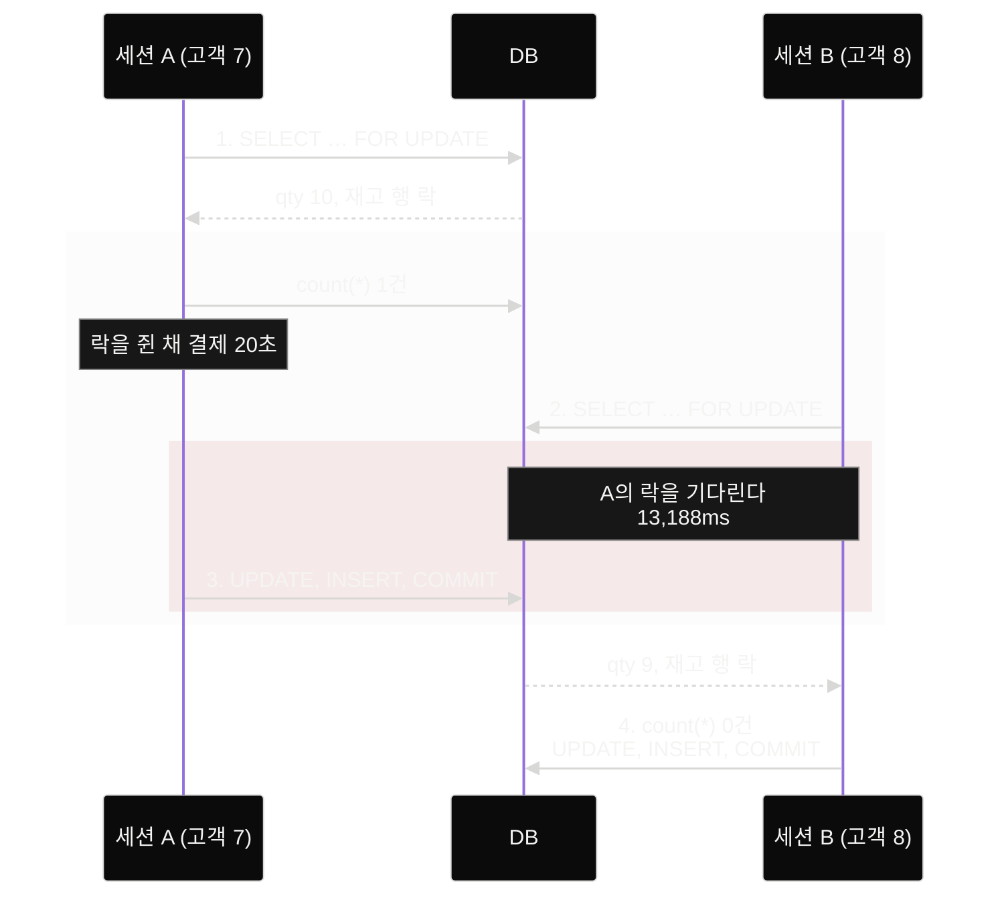
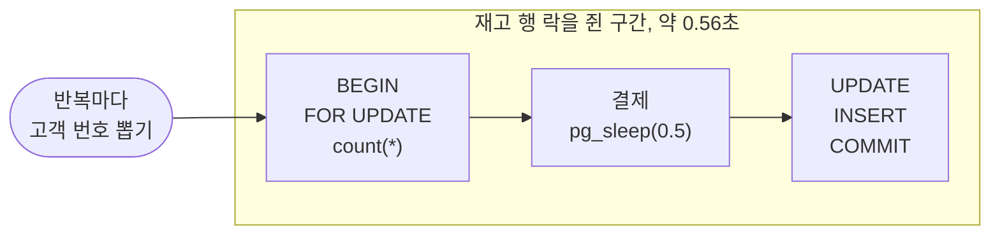
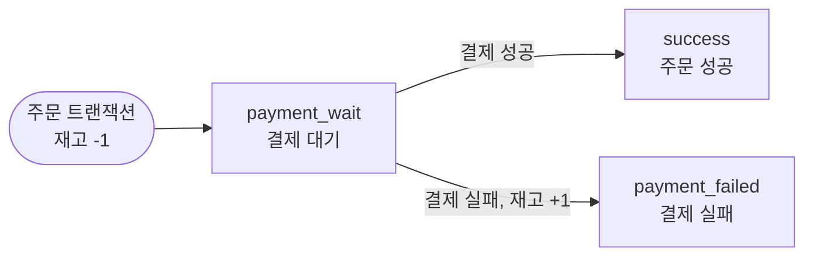
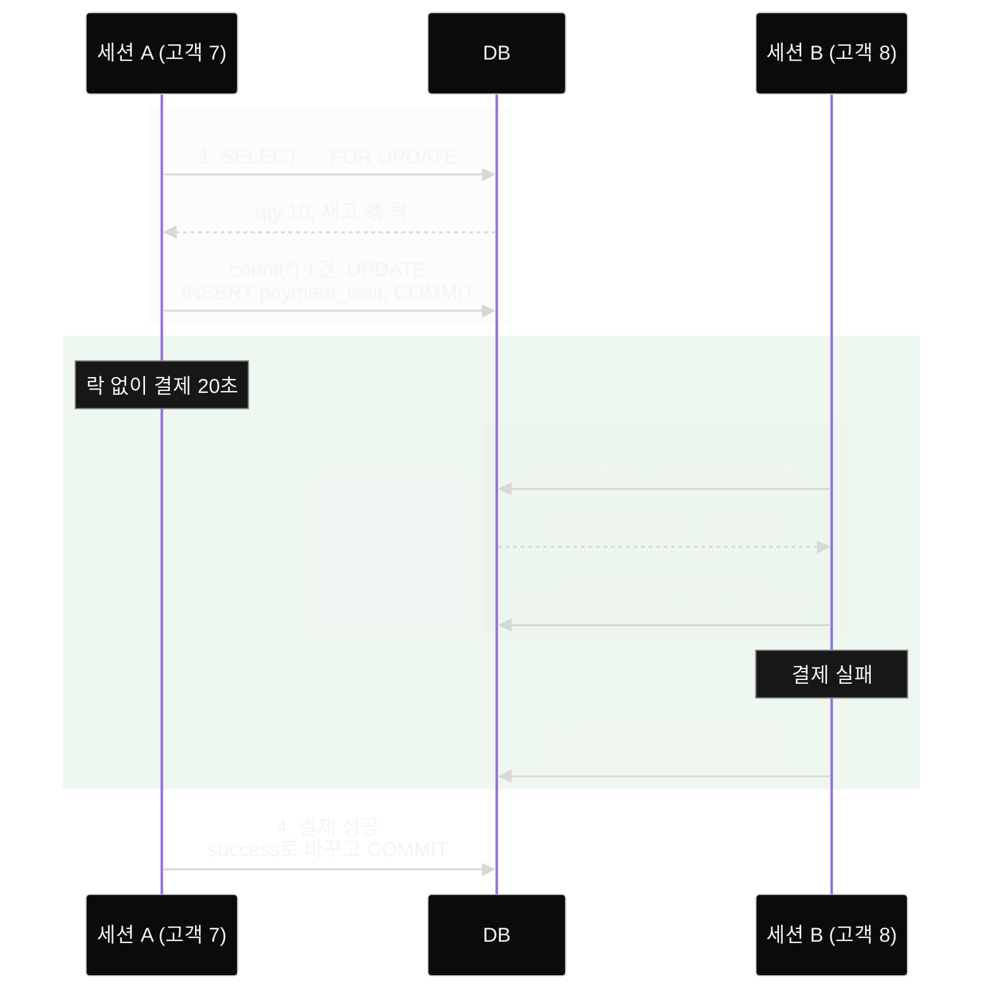
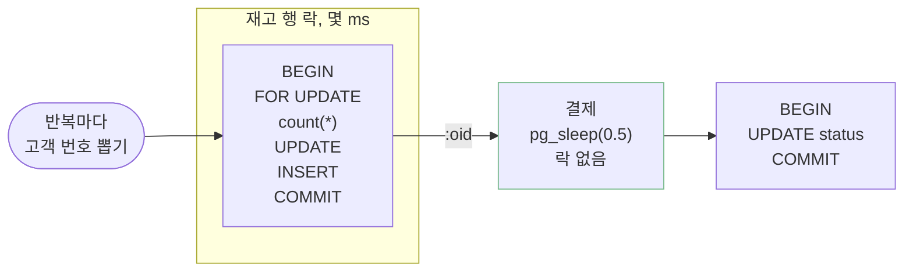
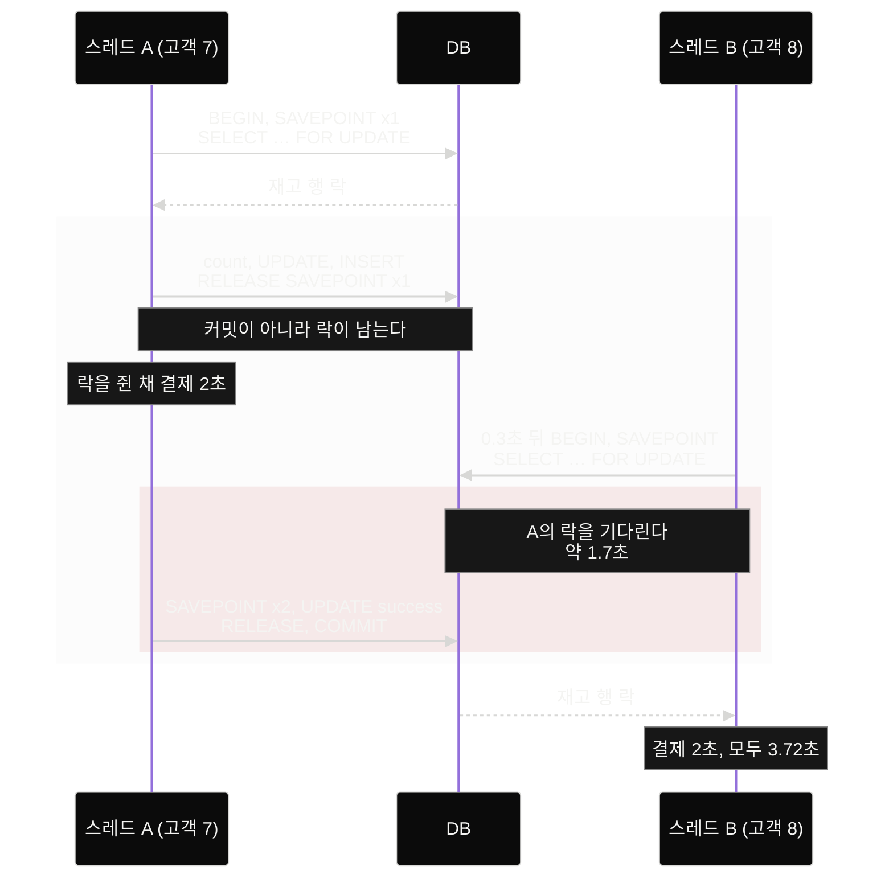

[2편](/posts/purchase-limit-lock-target)에서는 1인당 2개라는 구매 한도를 지켰다. 이 상품을 사는 주문이라면 모두 거쳐 가는 재고 행을 `SELECT … FOR UPDATE`로 먼저 잠그고 락을 잡은 뒤에 고객의 주문 수를 셌다. 재고 행을 잠근 동안 같은 상품을 사는 다른 고객의 주문은 기다렸지만 주문 수를 세고 주문을 넣는 짧은 시간이었다.

이번에는 주문에 결제를 붙였다. 2편의 트랜잭션 안에서 결제 API를 부르자 상관없는 고객의 주문이 결제가 끝날 때까지 기다렸다. 동시에 주문하는 고객을 10명으로 늘려도 처리량은 초당 2건을 넘지 못했다. 트랜잭션을 결제 앞뒤로 나누자 기다림이 사라지고 처리량이 10배가 됐다. 그런데 나눈 코드를 Django의 `ATOMIC_REQUESTS`로 감싸자 다시 결제가 끝날 때까지 기다렸다.

| 실험 | 결제하는 동안 재고 행 락 | 다른 고객의 주문 |
|---|---|---|
| 1. 결제를 트랜잭션 안에서 (SQL) | 쥐고 있다 | 결제가 끝날 때까지 기다린다. 10명이 동시에 주문하면 초당 1.79건 |
| 2. 결제 앞뒤로 트랜잭션 나누기 (SQL) | 풀려 있다 | 기다리지 않는다. 10명이 동시에 주문하면 초당 19.78건 |
| 3. 실험 2를 Django ORM으로 | 풀려 있다 | 기다리지 않는다 |
| 4. 실험 3을 `ATOMIC_REQUESTS`로 감싸기 | 쥐고 있다 | 결제가 끝날 때까지 기다린다 |

이 글에서는 이 상황을 psql 실험과 pgbench 측정, Django ORM 실험으로 재현하고 락을 쥔 시간이 처리량의 상한이 되는 이유와 트랜잭션을 나눌 때 함께 정해야 하는 주문 상태와 되돌리기를 정리한다.

## 실험 환경

2편과 같은 PostgreSQL 18 컨테이너(`pg-lab`)의 `shop` 데이터베이스와 Django 5.2 컨테이너를 썼다. 테이블도 2편의 `customer`, `stock`, `orders` 그대로다. 실험은 2편처럼 재고 10개, 고객 7이 이 상품을 이미 1개 산 상태에서 시작했다. 이번에는 같은 상품을 사는 다른 고객으로 고객 8을 추가했다.

```sql
INSERT INTO customer (id, name) VALUES (7, 'c7'), (8, 'c8');
INSERT INTO stock (id, qty) VALUES (1, 10);
INSERT INTO orders (customer_id, stock_id) VALUES (7, 1);
```

결제는 외부 결제 API 대신 `pg_sleep`으로 흉내 냈다. 결제 API가 응답하는 시간은 이쪽에서 줄일 수 없으니 그동안 DB에서 무엇이 붙잡혀 있는지만 본다. psql 창 두 개로 하는 실험은 창을 옮겨 명령을 칠 시간이 필요해서 결제를 20초로 두었다. 처리량 측정은 0.5초, Django 실험은 2초로 두었다.

## 결제를 트랜잭션 안에서 부르기

2편의 순서에서 결제를 넣을 자리는 한도를 확인한 다음, 재고를 줄이기 전이다. 한도를 넘은 고객에게 결제를 받으면 안 되고 결제가 실패하면 재고를 줄이지 않아야 하기 때문이다. A는 고객 7, B는 고객 8이다. B 창에서는 psql의 `\timing`을 켜서 문장마다 걸린 시간을 쟀다.

```sql
-- 1. A: 고객 7
BEGIN;
SELECT qty FROM stock WHERE id = 1 FOR UPDATE;                         -- qty 10, 행 락을 잡는다
SELECT count(*) FROM orders WHERE customer_id = 7 AND stock_id = 1;    -- 1, 한도 안이다
SELECT pg_sleep(20);                                                   -- 결제 API 응답을 기다린다
-- 2. B: 고객 8, A가 결제를 시작하고 약 7초 뒤
BEGIN;
SELECT qty FROM stock WHERE id = 1 FOR UPDATE;                         -- 결과가 나오지 않고 멈춘다
-- 3. A: 결제 성공
UPDATE stock SET qty = qty - 1 WHERE id = 1;                           -- UPDATE 1
INSERT INTO orders (customer_id, stock_id) VALUES (7, 1);
COMMIT;                                                                -- 이 순간 B에 qty 9가 뜬다
-- 4. B: 결제는 생략
SELECT count(*) FROM orders WHERE customer_id = 8 AND stock_id = 1;    -- 0
UPDATE stock SET qty = qty - 1 WHERE id = 1;                           -- UPDATE 1
INSERT INTO orders (customer_id, stock_id) VALUES (8, 1);
COMMIT;
```



B의 `SELECT … FOR UPDATE`는 13,188ms 만에 결과를 돌려줬다. 마지막 재고는 8이고 고객 7의 주문은 2건, 고객 8의 주문은 1건이다. 한도와 재고는 모두 맞았고 문제는 시간이다. 고객 8은 이 상품을 처음 사고 고객 7의 결제와 아무 관계가 없다. 그런데도 같은 재고 행을 잠가야 해서 A의 락이 풀리기를 기다렸다.

A의 락은 `SELECT … FOR UPDATE`에서 잡혀 `COMMIT`에서 풀렸다. 그 사이에 결제 20초가 들어 있다. B는 A가 결제를 시작하고 약 7초 뒤에 들어와 남은 13초를 기다렸다. 결제가 트랜잭션 안에 있으면 락을 쥔 시간이 결제 시간만큼 늘어난다.

### 연결을 늘려도 처리량이 그대로다

락을 쥔 시간이 처리량을 얼마나 깎는지는 PostgreSQL에 들어 있는 부하 측정 도구 pgbench로 쟀다. pgbench는 DB에 연결을 여러 개 열고 연결마다 주어진 SQL 스크립트를 정해진 시간 동안 쉬지 않고 반복한다. 스크립트를 한 번 끝까지 실행한 것을 트랜잭션 하나로 센다. 측정이 끝나면 초당 처리한 트랜잭션 수(tps)와 트랜잭션 하나에 걸린 평균 시간(latency average)을 보여 준다.

스크립트는 실험 1의 A와 같고 결제만 0.5초로 줄였다. `\set`은 pgbench 명령으로, 반복할 때마다 고객 번호를 1부터 1,000 사이에서 새로 뽑는다. 고객 1,000명을 미리 넣고 재고는 100,000개로 넉넉히 두었다. 처리량만 보는 측정이라 한도를 넘었을 때 주문하지 않는 분기는 넣지 않았다.

```sql
\set cid random(1, 1000)
BEGIN;
SELECT qty FROM stock WHERE id = 1 FOR UPDATE;
SELECT count(*) FROM orders WHERE customer_id = :cid AND stock_id = 1;
SELECT pg_sleep(0.5);
UPDATE stock SET qty = qty - 1 WHERE id = 1;
INSERT INTO orders (customer_id, stock_id) VALUES (:cid, 1);
COMMIT;
```



`pg-lab` 컨테이너 안에서 연결 하나(`-c 1`)와 열 개(`-c 10`)로 10초씩(`-T 10`) 돌렸다. 연결 하나가 psql 창 하나와 같으니 `-c 10`은 서로 다른 고객 10명이 동시에 주문을 반복하는 상황이다. `-n`은 pgbench가 자기 기본 테이블을 정리하는 단계를 건너뛰는 옵션이고 `-j`는 pgbench 쪽 스레드 수라 결과 해석과는 관계없다.

```sh
pgbench -U postgres -n -c 1 -j 1 -T 10 -f pay_inside.sql shop
pgbench -U postgres -n -c 10 -j 2 -T 10 -f pay_inside.sql shop
```

| 연결 수 | 처리한 주문 | tps | latency average |
|---|---|---|---|
| 1 | 18건 | 1.76 | 566.7ms |
| 10 | 26건 | 1.79 | 5,597.9ms |

연결을 10배로 늘려도 tps는 1.76에서 1.79로 거의 그대로였다. 모든 주문이 같은 재고 행의 락을 차례로 거쳐야 하기 때문이다. 주문 하나가 락을 쥐는 시간이 약 0.56초면 1초에 끝낼 수 있는 주문은 1 ÷ 0.56, 약 1.8건이다. 연결을 늘리면 그 줄에 서는 주문만 늘어난다.

대신 latency average가 10배가 됐다. 주문 하나가 락을 쥐고 일하는 시간은 그대로 약 0.56초인데 앞에 선 9건이 끝나기를 약 5초 기다렸다. 줄은 측정 시간이 끝난 뒤에도 남았다. pgbench는 10초가 지나면 새 주문을 시작하지 않지만 이미 줄을 선 주문은 끝까지 기다린다. 그래서 `-c 10`은 실제로 약 14.6초가 걸렸고 tps는 처리한 26건을 이 시간으로 나눈 값이다.

## 결제 앞뒤로 트랜잭션 나누기

결제하는 동안 락을 쥐지 않으려면 결제를 트랜잭션 밖으로 빼야 한다. 결제 API는 DB 밖에 있어서 트랜잭션을 `ROLLBACK`해도 이미 끝난 결제는 취소되지 않는다. 그래서 결제와 DB 변경을 나누면 한쪽이 실패했을 때 다른 쪽을 직접 되돌리는 일이 생긴다. 이미 커밋한 변경을 반대 방향의 변경으로 되돌리는 것을 보상이라고 부른다.

### 결제를 먼저 할까, 주문을 먼저 할까

나누는 방법은 두 가지다. 결제를 먼저 하고 주문 트랜잭션을 실행하거나, 주문 트랜잭션으로 재고를 먼저 줄이고 결제한다. 어느 쪽이든 두 번째 단계가 실패하면 첫 번째 단계를 되돌려야 한다.

재고가 1개 남았을 때 고객 10명이 동시에 주문하면 차이가 보인다. 결제를 먼저 하면 10명이 모두 결제하고 재고를 받은 1명을 뺀 9명의 결제를 외부 결제사에 취소 요청해야 한다. 그 요청도 실패할 수 있다. 주문을 먼저 하면 재고를 줄이는 데 성공한 1명만 결제로 넘어가고 나머지 9명은 결제 전에 품절을 확인한다. 되돌릴 일은 그 1명의 결제가 실패할 때만 생기고 재고를 1 늘리는 일이라 서비스 DB 안에서 끝난다. 그래서 주문을 먼저 하기로 했다.

### 주문 상태 컬럼

주문을 먼저 하면 재고는 줄었는데 결제는 아직 끝나지 않은 주문이 생긴다. 지금 `orders` 테이블에는 이 주문을 결제가 끝난 주문과 구분할 방법이 없다. 결제 정보 컬럼을 nullable로 두고 null이면 결제 전으로 보는 방법은 결제가 실패한 경우를 담지 못한다. 결제 중인 주문과 결제에 실패해 무효가 된 주문이 똑같이 null이 된다. 실패한 주문 행을 지우면 둘은 구분되지만 고객이 주문했다가 결제에 실패했다는 이력이 사라진다.

그래서 주문 상태를 나타내는 `status` 컬럼을 추가했다. 주문 트랜잭션은 주문을 `payment_wait`로 넣고 결제 결과에 따라 `success`나 `payment_failed`로 바꾼다.



1인당 한도를 셀 때는 `payment_wait`와 `success`를 넣는다. 결제 중인 주문을 빼면 결제를 마치기 전에 주문을 여러 개 만들어 두는 식으로 한도를 넘을 수 있다. `payment_failed`는 넣지 않는다. 넣으면 결제에 실패해 산 것이 없는 고객이 더 사지 못한다.

Django 모델에는 이렇게 추가했다.

```python
class Order(models.Model):
    class Status(models.TextChoices):
        PAYMENT_WAIT = "payment_wait"
        PAYMENT_FAILED = "payment_failed"
        SUCCESS = "success"

    customer = models.ForeignKey(Customer, on_delete=models.PROTECT)
    stock = models.ForeignKey(Stock, on_delete=models.PROTECT)
    status = models.CharField(max_length=20, choices=Status.choices, default=Status.PAYMENT_WAIT)

    class Meta:
        db_table = "orders"
```

Django의 `default`는 객체를 만들 때 파이썬 쪽에서 채우는 값이라 마이그레이션이 끝나면 DB 컬럼에는 기본값이 남지 않는다. 그래서 psql에서 `INSERT`할 때는 `status`를 직접 적었고 실험을 시작할 때 넣는 고객 7의 기존 주문도 `'success'`로 넣었다.

### 두 트랜잭션으로 나눈 실험

실험 1을 두 트랜잭션으로 나눠 다시 실행했다. 주문 트랜잭션은 재고 행을 잠그고 한도를 확인하고 재고를 줄인 뒤 주문을 `payment_wait`로 넣는다. 결제는 커밋한 뒤에 하고 결과 트랜잭션에서 상태를 바꾼다. A는 결제에 성공하고 B는 결제에 실패했다고 쳤다.

```sql
-- 1. A: 고객 7의 주문 트랜잭션
BEGIN;
SELECT qty FROM stock WHERE id = 1 FOR UPDATE;    -- qty 10, 행 락을 잡는다
SELECT count(*) FROM orders WHERE customer_id = 7 AND stock_id = 1
  AND status IN ('payment_wait', 'success');      -- 1
UPDATE stock SET qty = qty - 1 WHERE id = 1;
INSERT INTO orders (customer_id, stock_id, status)
  VALUES (7, 1, 'payment_wait') RETURNING id;     -- id 2
COMMIT;                                           -- 락이 풀린다
SELECT pg_sleep(20);                              -- 결제, 트랜잭션 밖
-- 2. B: 고객 8의 주문 트랜잭션, A가 결제하는 동안
BEGIN;
SELECT qty FROM stock WHERE id = 1 FOR UPDATE;    -- 바로 qty 9
SELECT count(*) FROM orders WHERE customer_id = 8 AND stock_id = 1
  AND status IN ('payment_wait', 'success');      -- 0
UPDATE stock SET qty = qty - 1 WHERE id = 1;
INSERT INTO orders (customer_id, stock_id, status)
  VALUES (8, 1, 'payment_wait') RETURNING id;     -- id 3
COMMIT;
-- 3. B: 결제 실패
BEGIN;
UPDATE orders SET status = 'payment_failed' WHERE id = 3;
UPDATE stock SET qty = qty + 1 WHERE id = 1;
COMMIT;
-- 4. A: 결제 성공
BEGIN;
UPDATE orders SET status = 'success' WHERE id = 2;
COMMIT;
```



이번에는 B의 `SELECT … FOR UPDATE`가 0.4ms 만에 돌아왔다. 실험 1에서 13,188ms를 기다린 바로 그 문장이다. A는 주문 트랜잭션을 커밋하고 결제를 시작했으므로 결제하는 동안 재고 행에는 아무 락도 없었다. 마지막 재고는 10에서 A와 B가 1씩 줄이고 B의 실패로 1을 되돌린 9다. 주문은 고객 7의 기존 주문과 새 주문이 `success`, 고객 8의 주문이 `payment_failed`로 남았다.

3번에서 상태 변경과 재고 복원을 한 트랜잭션에 넣은 데는 이유가 있다. 상태만 `payment_failed`로 바뀌고 재고 복원이 빠지면 1개가 영영 팔리지 않는 재고가 된다. 재고만 늘고 주문이 `payment_wait`로 남으면 그 주문이 계속 한도에 세어진다. 겉으로는 아직 결제 중인 주문이라 누군가 실패 처리를 다시 실행하면 재고가 한 번 더 늘어난다. 그때부터는 실제보다 1개를 더 팔게 된다. 한 트랜잭션에 넣으면 두 문장은 함께 반영되거나 함께 취소된다.

### 처리량 다시 재기

실험 1과 같은 조건으로 나눈 스크립트를 돌렸다. `\gset`은 `INSERT`가 돌려준 id를 `:oid` 변수에 담는 pgbench 명령이다.

```sql
\set cid random(1, 1000)
BEGIN;
SELECT qty FROM stock WHERE id = 1 FOR UPDATE;
SELECT count(*) FROM orders WHERE customer_id = :cid AND stock_id = 1 AND status IN ('payment_wait', 'success');
UPDATE stock SET qty = qty - 1 WHERE id = 1;
INSERT INTO orders (customer_id, stock_id, status) VALUES (:cid, 1, 'payment_wait') RETURNING id AS oid \gset
COMMIT;
SELECT pg_sleep(0.5);
BEGIN;
UPDATE orders SET status = 'success' WHERE id = :oid;
COMMIT;
```



| 결제 위치 | 연결 수 | 처리한 주문 | tps | latency average |
|---|---|---|---|---|
| 트랜잭션 안 | 1 | 18건 | 1.76 | 566.7ms |
| 트랜잭션 안 | 10 | 26건 | 1.79 | 5,597.9ms |
| 두 트랜잭션 사이 | 1 | 20건 | 1.98 | 506.1ms |
| 두 트랜잭션 사이 | 10 | 200건 | 19.78 | 505.5ms |

연결을 10배로 늘리자 tps도 1.98에서 19.78로 10배가 됐다. latency average는 연결이 하나일 때와 같은 505.5ms다. 줄을 서는 시간이 거의 없었다는 뜻이다.

연결이 하나일 때 주문 하나는 506.1ms가 걸렸다. 결제 0.5초를 빼면 두 트랜잭션이 DB에서 쓰는 시간은 약 6ms이고 재고 행 락은 그중 주문 트랜잭션 동안만 쥔다. 한 바퀴의 1% 남짓이다. 첫 바퀴가 지나면 연결 10개가 결제하는 시점이 저마다 흩어진다. 그래서 락에 도착했을 때 다른 연결이 락을 쥐고 있는 경우가 드물다. 상한도 바뀌었다. 연결 10개가 각각 약 0.5초에 주문 하나씩 끝내니 초당 20건 가까이가 나온다. 이제 처리량을 정하는 것은 재고 행 락이 아니라 연결 수와 결제 시간이다.

<figure class="lock-timeline-figure" style="margin: 2rem 0;">
<svg viewBox="0 0 680 420" width="100%" role="img" aria-labelledby="lock-timeline-title lock-timeline-desc" xmlns="http://www.w3.org/2000/svg" style="display:block;height:auto;max-width:680px" font-family="Pretendard Variable, Pretendard, -apple-system, BlinkMacSystemFont, sans-serif">
<title id="lock-timeline-title">결제 위치에 따라 주문 세 건이 재고 행 락을 쥐고 기다리는 시간</title>
<desc id="lock-timeline-desc">가로축은 0초부터 1.8초까지의 시간이다. 위는 결제를 트랜잭션 안에서 부를 때로, 주문 세 건이 재고 행 락을 0.56초씩 차례로 쥔다. 주문 2는 0.56초, 주문 3은 1.12초를 기다리고 주문 3은 1.68초에 끝난다. 아래는 결제 앞뒤로 트랜잭션을 나눌 때로, 락은 주문 트랜잭션의 몇 ms 동안만 쥐고 결제 0.5초는 락 없이 동시에 진행되어 세 주문이 약 0.51초에 함께 끝난다.</desc>
<rect x="0.5" y="0.5" width="679" height="419" fill="#090909" stroke="#303030"/>
<text x="24" y="40" fill="#f4f4f2" font-size="20" font-weight="600">결제를 트랜잭션 안에서 부를 때</text>
<text x="24" y="70" fill="#f4f4f2" font-size="16">주문 1</text>
<rect x="110" y="52" width="164.9" height="26" fill="#d8d8d6" fill-opacity="0.22" stroke="#d8d8d6"/>
<text x="118" y="70" fill="#f4f4f2" font-size="14">락 보유, 결제 포함</text>
<text x="24" y="110" fill="#f4f4f2" font-size="16">주문 2</text>
<rect x="110" y="92" width="164.9" height="26" fill="#d27b7b" fill-opacity="0.35"/>
<text x="118" y="110" fill="#f4f4f2" font-size="14">대기</text>
<rect x="274.9" y="92" width="164.9" height="26" fill="#d8d8d6" fill-opacity="0.22" stroke="#d8d8d6"/>
<text x="282.9" y="110" fill="#f4f4f2" font-size="14">락 보유</text>
<text x="24" y="150" fill="#f4f4f2" font-size="16">주문 3</text>
<rect x="110" y="132" width="329.8" height="26" fill="#d27b7b" fill-opacity="0.35"/>
<text x="118" y="150" fill="#f4f4f2" font-size="14">대기</text>
<rect x="439.8" y="132" width="164.9" height="26" fill="#d8d8d6" fill-opacity="0.22" stroke="#d8d8d6"/>
<text x="447.8" y="150" fill="#f4f4f2" font-size="14">락 보유</text>
<text x="612" y="150" fill="#858585" font-size="14">1.68초</text>
<text x="24" y="214" fill="#f4f4f2" font-size="20" font-weight="600">결제 앞뒤로 트랜잭션을 나눌 때</text>
<text x="24" y="244" fill="#f4f4f2" font-size="16">주문 1</text>
<rect x="110" y="226" width="3" height="26" fill="#d8d8d6"/>
<rect x="113" y="226" width="147.2" height="26" fill="#78b98c" fill-opacity="0.35" stroke="#78b98c"/>
<text x="121" y="244" fill="#f4f4f2" font-size="14">결제, 락 없음</text>
<rect x="260.2" y="226" width="3" height="26" fill="#d8d8d6"/>
<text x="24" y="284" fill="#f4f4f2" font-size="16">주문 2</text>
<rect x="112" y="266" width="3" height="26" fill="#d8d8d6"/>
<rect x="115" y="266" width="147.2" height="26" fill="#78b98c" fill-opacity="0.35" stroke="#78b98c"/>
<text x="123" y="284" fill="#f4f4f2" font-size="14">결제, 락 없음</text>
<rect x="262.2" y="266" width="3" height="26" fill="#d8d8d6"/>
<text x="24" y="324" fill="#f4f4f2" font-size="16">주문 3</text>
<rect x="114" y="306" width="3" height="26" fill="#d8d8d6"/>
<rect x="117" y="306" width="147.2" height="26" fill="#78b98c" fill-opacity="0.35" stroke="#78b98c"/>
<text x="125" y="324" fill="#f4f4f2" font-size="14">결제, 락 없음</text>
<rect x="264.2" y="306" width="3" height="26" fill="#d8d8d6"/>
<text x="282" y="244" fill="#858585" font-size="14">흰 막대: 주문 트랜잭션과 결과 트랜잭션, 몇 ms</text>
<text x="282" y="324" fill="#858585" font-size="14">약 0.51초</text>
<line x1="110" y1="360" x2="640" y2="360" stroke="#858585"/>
<line x1="110" y1="360" x2="110" y2="367" stroke="#858585"/>
<text x="110" y="390" fill="#858585" font-size="16" text-anchor="middle">0초</text>
<line x1="257.2" y1="360" x2="257.2" y2="367" stroke="#858585"/>
<text x="257.2" y="390" fill="#858585" font-size="16" text-anchor="middle">0.5초</text>
<line x1="404.4" y1="360" x2="404.4" y2="367" stroke="#858585"/>
<text x="404.4" y="390" fill="#858585" font-size="16" text-anchor="middle">1.0초</text>
<line x1="551.7" y1="360" x2="551.7" y2="367" stroke="#858585"/>
<text x="551.7" y="390" fill="#858585" font-size="16" text-anchor="middle">1.5초</text>
</svg>
</figure>

## Django ORM으로 옮기기

나눈 흐름을 Django 코드로 옮겼다. `reserve()`가 주문 트랜잭션, `complete()`가 결과 트랜잭션이고 `buy()`는 그 사이에서 결제를 부른다. `pay()`는 결제 API 대신 2초를 기다렸다가 성공을 돌려준다.

```python
from django.db import transaction
from django.db.models import F

LIMIT = 2


def reserve(customer_id, stock_id):
    with transaction.atomic():
        stock = Stock.objects.select_for_update().get(id=stock_id)
        bought = Order.objects.filter(
            customer_id=customer_id,
            stock_id=stock_id,
            status__in=[Order.Status.PAYMENT_WAIT, Order.Status.SUCCESS],
        ).count()
        if bought >= LIMIT or stock.qty <= 0:
            return None
        Stock.objects.filter(id=stock_id).update(qty=F("qty") - 1)
        return Order.objects.create(
            customer_id=customer_id,
            stock_id=stock_id,
            status=Order.Status.PAYMENT_WAIT,
        )


def complete(order, paid):
    with transaction.atomic():
        if paid:
            Order.objects.filter(id=order.id).update(status=Order.Status.SUCCESS)
        else:
            Order.objects.filter(id=order.id).update(status=Order.Status.PAYMENT_FAILED)
            Stock.objects.filter(id=order.stock_id).update(qty=F("qty") + 1)


def buy(customer_id, stock_id):
    order = reserve(customer_id, stock_id)
    if order is None:
        return False
    paid = pay(order)  # 트랜잭션 밖
    complete(order, paid)
    return paid
```

`CaptureQueriesContext`로 `buy()`가 보내는 SQL을 확인하면 psql 실험과 같은 순서로 `BEGIN`과 `COMMIT`이 두 번 나가고 결제는 첫 `COMMIT`과 두 번째 `BEGIN` 사이에 있다. 결제가 실패하면 `complete()`는 상태 변경과 재고 복원을 한 트랜잭션으로 보낸다.

동시 실행은 2편처럼 스레드 두 개로 재현했다. A는 고객 7, B는 고객 8이고 B는 A보다 0.3초 늦게 `buy()`를 호출한다.

```text
buy: A 성공 2.01초, B 성공 2.02초 / 재고 8
```

B가 걸린 2.02초는 자기 결제 2초다. A의 결제를 기다리지 않았다.

### ATOMIC_REQUESTS로 감싸면

`ATOMIC_REQUESTS`는 Django 데이터베이스 설정이다. `True`로 두면 Django는 뷰 함수를 호출하기 전에 트랜잭션을 열고 뷰가 예외 없이 응답을 만들면 커밋한다. 이 설정을 켠 프로젝트의 뷰에서 `buy()`를 부르면 아래 함수와 같은 모양이 된다.

```python
def buy_in_atomic_request(customer_id, stock_id):
    with transaction.atomic():
        return buy(customer_id, stock_id)
```

```text
buy_in_atomic_request: A 성공 2.01초, B 성공 3.72초 / 재고 8
```

재고와 주문은 똑같이 맞았지만 B가 3.72초 걸렸다. A의 결제가 끝날 때까지 약 1.7초를 기다리고 자기 결제 2초를 했다. `CaptureQueriesContext`로 본 SQL에 이유가 있다.

```sql
BEGIN
SAVEPOINT "s279160368248000_x1"
SELECT "stock"."id", "stock"."qty" FROM "stock" WHERE "stock"."id" = 1 LIMIT 21 FOR UPDATE
SELECT COUNT(*) AS "__count" FROM "orders" WHERE ("orders"."customer_id" = 8 AND "orders"."status" IN ('payment_wait', 'success') AND "orders"."stock_id" = 1)
UPDATE "stock" SET "qty" = ("stock"."qty" - 1) WHERE "stock"."id" = 1
INSERT INTO "orders" ("customer_id", "stock_id", "status") VALUES (8, 1, 'payment_wait') RETURNING "orders"."id"
RELEASE SAVEPOINT "s279160368248000_x1"
SAVEPOINT "s279160368248000_x2"
UPDATE "orders" SET "status" = 'success' WHERE "orders"."id" = 2
RELEASE SAVEPOINT "s279160368248000_x2"
COMMIT
```



`atomic()` 블록 안에서 다시 `atomic()`을 열면 Django는 새 트랜잭션을 시작하지 않고 세이브포인트를 만든다. 세이브포인트는 트랜잭션 안에 찍어 두는 중간 지점으로, 그 지점 이후의 변경만 되돌릴 수 있게 해 준다. `reserve()`의 블록이 끝날 때 나가는 것은 `RELEASE SAVEPOINT`이고 커밋이 아니다. 행 락은 트랜잭션이 끝날 때 풀리므로 재고 행의 락은 결제와 `complete()`를 지나 맨 바깥의 `COMMIT`까지 남는다.

`buy()`의 코드는 한 글자도 바뀌지 않았다. 트랜잭션을 둘로 나눈 함수라도 호출하는 쪽이 이미 트랜잭션을 열어 두었으면 하나로 합쳐진다. 주문을 한 번에 하나씩만 넣는 테스트로는 두 경우 모두 통과한다. Django는 특정 뷰만 `ATOMIC_REQUESTS`에서 빼는 `non_atomic_requests` 데코레이터를 제공한다. 이 실험은 뷰 없이 함수로 재현해서 데코레이터는 돌려 보지 않았다.

## 정리

1인당 한도를 지키던 2편의 트랜잭션에 결제를 붙였다. 결제를 트랜잭션 안에서 부르면 재고 행의 락을 결제 시간만큼 쥐었다. 같은 상품을 사는 상관없는 고객은 그동안 결제가 끝나기를 기다렸다. 같은 행을 잠그는 주문은 한 줄로 서므로 처리량은 1 ÷ 락을 쥔 시간을 넘지 못했고 연결을 늘리면 줄만 길어졌다.

트랜잭션을 결제 앞뒤로 나누자 락을 쥔 시간이 결제 시간에서 몇 ms로 줄었고 처리량은 연결 수만큼 늘었다. 나누는 대신 두 가지를 정해야 했다. 결제 중인 주문을 구분하는 상태 컬럼, 그리고 결제가 실패했을 때 상태 변경과 재고 복원을 한 트랜잭션에서 하는 되돌리기다. Django에서는 `ATOMIC_REQUESTS`처럼 바깥에서 연 트랜잭션이 나눈 트랜잭션을 다시 하나로 합칠 수 있다.

남은 문제가 있다. 주문 트랜잭션이 커밋된 뒤 결제가 끝나기 전에 고객이 결제창을 닫거나 서버가 죽으면 주문은 `payment_wait`로 남는다. 재고는 이미 줄었으니 아무도 사지 않은 1개가 계속 팔리지 않고 그 고객의 한도에도 계속 세어진다. 다음 글에서는 이렇게 남은 주문을 정리하는 작업을 다룬다.

락은 DB 안에서 끝나는 일에만 쥐고 결제처럼 밖의 응답을 기다리는 일은 트랜잭션 사이로 빼야 한다.

## 참고

- [PostgreSQL 18 문서: pgbench](https://www.postgresql.org/docs/18/pgbench.html)
- [PostgreSQL 18 문서: SAVEPOINT](https://www.postgresql.org/docs/18/sql-savepoint.html)
- [PostgreSQL 18 문서: Row-Level Locks](https://www.postgresql.org/docs/18/explicit-locking.html#LOCKING-ROWS)
- [Django 5.2 문서: Database transactions](https://docs.djangoproject.com/en/5.2/topics/db/transactions/)
